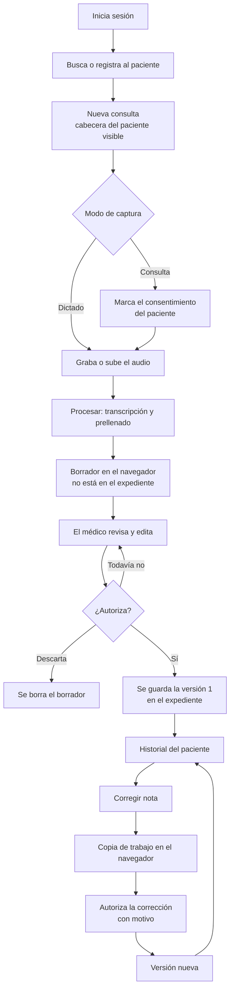
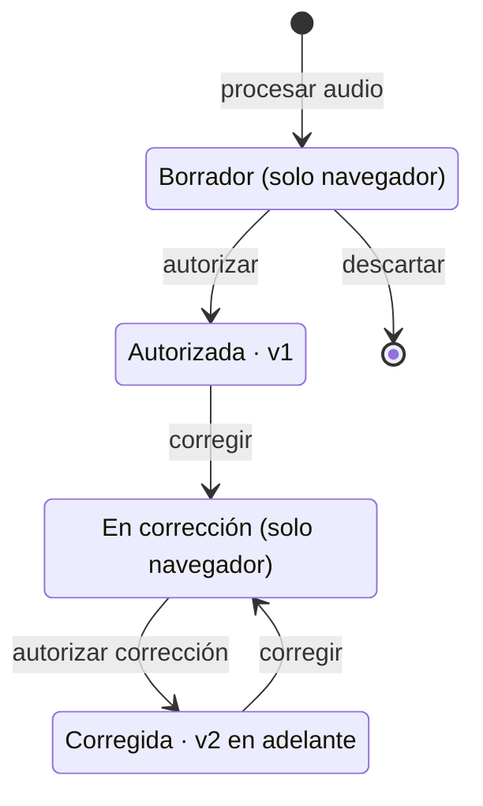
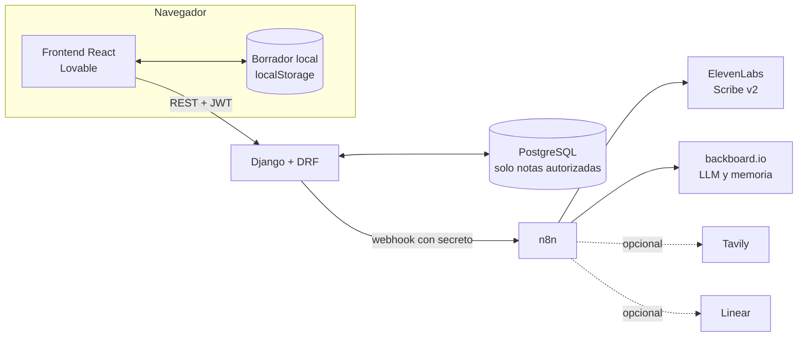
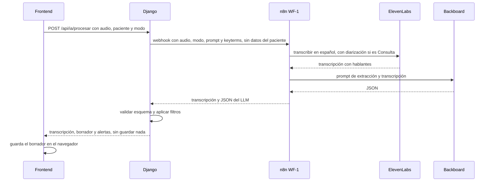

# VozClínica: requerimientos del MVP

> Asistente de documentación clínica por voz · Hackathon de 2 días · Equipo de 3
>
> **Versión 1.0 · 28/oct/2026.** Para todo lo que se construye en el hackathon, este documento reemplaza a la propuesta inicial ([`referencias/propuesta-inicial-VozClinica.md`](referencias/propuesta-inicial-VozClinica.md)).

## Contexto en 5 minutos

**Qué es.** VozClínica convierte el audio de una consulta médica en una nota clínica prellenada. La IA transcribe y llena el Formato Clínico General; el médico revisa, corrige y autoriza. Solo lo autorizado entra al expediente.

**El flujo en una línea.** Elegir paciente → grabar (dictado o consulta) → la IA prellena el formato → el médico edita → autoriza → la nota entra al expediente → si hace falta, se corrige y se crea una versión nueva.

**Reglas que no se rompen**
1. **Nada se guarda antes de autorizar** (D-02). El borrador vive solo en el navegador y el audio nunca se guarda.
2. **Corregir no sobrescribe** (D-03). Cada corrección autorizada es una versión nueva e inmutable.
3. **La IA solo usa lo que se dijo.** Negado no es lo mismo que sin información, y la IA no diagnostica, no prescribe ni sugiere.
4. **La identificación sale del expediente** y es de solo lectura en la nota (P-01).
5. **Al LLM solo le llega la transcripción** (D-13), nunca datos del paciente.
6. **Solo datos ficticios** en todo el hackathon.

**Stack y herramientas.** React generado con **Lovable** · **Django** + DRF · **PostgreSQL** · **n8n** orquesta · **ElevenLabs** Scribe v2 transcribe (y su TTS genera los audios de prueba) · **backboard.io** da el LLM y la memoria · **Tavily** busca referencias (opcional) · **Linear** lleva el backlog.

**Equipo**

| Quién | Rol | Guía |
|---|---|---|
| German | Frontend con Lovable, Linear y demo | [`equipo/german-frontend.md`](equipo/german-frontend.md) |
| Jeroben | Backend Django, n8n (infraestructura) y despliegue | [`equipo/jeroben-backend.md`](equipo/jeroben-backend.md) |
| Luis | IA: esquema, transcripción, prompt, filtros, workflows y evaluación | [`equipo/luis-ia.md`](equipo/luis-ia.md) |

**Qué leer de este documento**

| Quién | Secciones | Tiempo |
|---|---|---|
| Todos | Este resumen · §2 Decisiones · §3 Alcance · §5 Flujo y estados · §14 Guion de demo · §16 Pendientes | 10–15 min |
| German, además | §6 Requerimientos funcionales · §7 Plantilla · §10 Interfaz y design system · §12 Criterios de aceptación | 15 min |
| Jeroben, además | §6 · §9 Arquitectura (sobre todo 9.3 a 9.6) · §11 No funcionales · §12 | 15 min |
| Luis, además | §7 Plantilla · §8 IA · §9.2 y 9.3 · §12 | 15 min |

Después, cada quien sigue con su guía: ahí están sus tareas, su plan por hitos y los contratos con los demás.

**Contratos que no se cambian sin avisar a los otros dos:** las claves de los campos (§7.2), la API ([guía de Jeroben, §6](equipo/jeroben-backend.md)), la interfaz del paquete de IA y el webhook de n8n ([guía de Luis, §6 y §10](equipo/luis-ia.md)).

## 0. Cómo leer este documento

- **Prioridad (MoSCoW):** **M** = indispensable para la demo · **S** = deseable · **C** = opcional, si sobra tiempo · **W** = fuera del hackathon.
- **Identificadores:** `D-xx` decisión · `RF-xx` requerimiento funcional · `RNF-xx` requerimiento no funcional · `CA-xx` criterio de aceptación · `P-xx` pendiente · `VC-xx` tarea de Linear.
- Todos los datos de pacientes y médicos son **ficticios**.

## 1. Resumen

**Problema.** Los médicos dedican una parte importante de cada consulta a redactar la nota clínica y actualizar el expediente.

**Solución.** El médico graba la consulta o dicta. La IA transcribe el audio y **prellena el Formato Clínico General**. El médico revisa, corrige y **autoriza**, y solo la nota autorizada entra al expediente.

**Lema.** *Menos tiempo escribiendo, más tiempo atendiendo.*

**Qué tiene que probar la demo:** audio → formato prellenado → revisión del médico → nota autorizada en el expediente correcto, sin capturar desde cero y sin que nada se guarde sin visto bueno.

## 2. Decisiones tomadas

| ID | Decisión | Origen |
|---|---|---|
| D-01 | Hay dos modos de captura: **Dictado** (el médico le habla a la app) y **Consulta** (se graba la conversación entre médico y paciente). Los dos usan el mismo flujo. | Equipo |
| D-02 | **No se guarda nada en el servidor ni en la base de datos hasta que el médico autoriza.** El borrador vive solo en el navegador. El audio nunca se guarda. | Equipo |
| D-03 | Una nota autorizada **sí se puede editar**. Cada corrección crea una **versión nueva** que se vuelve a autorizar. Las versiones anteriores se conservan sin cambios. | Equipo |
| D-04 | Plantilla única del MVP: **Formato Clínico General v1.1**, definida como esquema JSON con versión. | Equipo |
| D-05 | Stack: React (generado con Lovable), Django con Django REST Framework y PostgreSQL. | Equipo |
| D-06 | La interfaz se basa en el **Design System Clínico v0.4** (§10). | Equipo |
| D-07 | Transcripción con **ElevenLabs Scribe v2**, extracción con un LLM vía **backboard.io** y orquestación con **n8n**. No se entrenan ni se ajustan modelos propios. | Propuesta del análisis |
| D-08 | El paciente se **elige antes de grabar**. El nombre que la IA detecte en el audio solo sirve para verificar. | Propuesta del análisis (resuelve una contradicción de la propuesta inicial) |
| D-09 | Estados de la nota: **Borrador** (solo en el navegador) → **Autorizada** (versión 1) → **Corregida** (versión 2 en adelante). | Unifica la propuesta inicial, la plantilla y el DS |
| D-10 | El verbo es **"Autorizar"**, no "Firmar": el MVP no tiene firma electrónica. | Plantilla |
| D-11 | Hay un solo rol: **médico**. Registra pacientes y captura la consulta. | DS (D1, D16) |
| D-12 | La validación del esquema y los filtros corren en Django, con el paquete Python `ia/vozclinica_ia` (el mismo que usa la evaluación). n8n solo orquesta la transcripción y la llamada al LLM. | Guías del equipo |
| D-13 | Al LLM no se le envían el nombre ni los datos del paciente: solo la transcripción. La comparación de nombres se hace en Django. | Guías del equipo |
| D-14 | Reparto: **German** (A) frontend, **Jeroben** (B) backend y despliegue, **Luis** (C) IA. Cada quien tiene su guía en [`equipo/`](equipo/). | Equipo |

## 3. Alcance

### 3.1 Dentro del MVP

**M (indispensable)**
1. Inicio de sesión del médico.
2. Pacientes ficticios: lista, búsqueda y registro mínimo.
3. Consulta nueva con el paciente elegido y su cabecera siempre visible.
4. Grabar audio o subir un archivo, en modo Dictado o Consulta.
5. Transcripción y prellenado del Formato Clínico General.
6. Revisión y edición de todos los campos clínicos, con el borrador guardado solo en el navegador.
7. Autorización con confirmación: la nota entra al expediente.
8. Expediente con el historial de notas autorizadas y la vista de cada nota.
9. Corrección de notas autorizadas con versiones.
10. Audios sintéticos para desarrollo y demo.

**S (deseable)**
- Evidencia por campo (qué parte del audio respalda cada dato) y filtro contra datos inventados.
- Alerta si el nombre que se menciona en el audio no coincide con el paciente.
- Panel de transcripción separado por hablante.
- Validación de signos vitales e IMC calculado.
- Agregar un segundo audio al mismo borrador.
- "Pregúntale al expediente" con Backboard, solo sobre notas autorizadas.
- Bitácora de accesos y cambios.
- Exportar la nota autorizada a PDF.
- Evaluación de la precisión de la IA con los audios sintéticos.

**C (opcional)**
- Referencias de apoyo con Tavily.
- Alerta de alergia contra el medicamento indicado.
- Búsqueda de CIE-10 en un catálogo corto.
- Transcripción en vivo mientras se graba.
- "Reportar error de la IA" que crea un issue en Linear.
- Modo oscuro (los tokens ya lo soportan).
- Comparación visual entre versiones de una nota.
- Identificar al paciente por voz sin haberlo elegido antes.

### 3.2 Fuera del hackathon (W)

Agenda, citas y próxima cita (DS 6.8 y 7.8) · PWA y trabajo sin conexión con sincronización (DS §9) · reglas para varias pestañas (DS 8.2) · otros roles (enfermería, recepción) · firma electrónica · HL7 FHIR · plantillas por especialidad · impresión de receta · indicadores operativos.

## 4. Supuestos

- Un solo tipo de usuario: el médico, en escritorio (lienzo de 1366 × 768, DS D2), con Chrome o Edge recientes.
- Interfaz y audio en español de México.
- Hay conexión a internet: todo el procesamiento de IA ocurre en la nube.
- Los datos son ficticios, pero el diseño respeta las reglas de privacidad del §11 para que el producto sea creíble.

## 5. Flujo

### 5.1 Flujo principal



### 5.2 Estados de la nota



Si se descarta una corrección, la nota se queda como estaba.

| Estado | Dónde vive | ¿Aparece en el expediente? | Insignia (DS 6.5) |
|---|---|---|---|
| Borrador | Navegador | No | `b-draft` · "Borrador · solo en este equipo" |
| Autorizada | Base de datos (versión 1) | Sí | `b-success` · "Autorizada" |
| En corrección | Navegador; la base de datos conserva la versión vigente | Sí, la versión vigente | `b-draft` · "Corrección sin autorizar" |
| Corregida | Base de datos (versión 2 en adelante) | Sí, la última versión; las anteriores en "Versiones" | `b-success` · "Corregida · v2" |

## 6. Requerimientos funcionales

### 6.1 Acceso

| ID | Requerimiento | Prio. |
|---|---|---|
| RF-01 | Inicio de sesión con usuario y contraseña, y sesión con JWT. Médicos ficticios precargados con nombre, cédula y especialidad. | M |
| RF-02 | Cerrar sesión. Si hay un borrador sin autorizar, se avisa antes. | M |

### 6.2 Pacientes y expediente

| ID | Requerimiento | Prio. |
|---|---|---|
| RF-03 | Lista y búsqueda de pacientes por nombre, expediente o fecha de nacimiento, sin importar acentos. | M |
| RF-04 | Registro mínimo: nombre(s), apellido paterno, apellido materno (opcional), fecha de nacimiento, sexo y alergias ("Sin alergias conocidas" se escribe explícito). Antes de registrar se muestran las coincidencias para evitar duplicados (DS 7.7). El número de expediente lo asigna el sistema. | M |
| RF-05 | De 6 a 8 pacientes ficticios precargados. Algunos tienen notas previas y uno es alérgico a la penicilina. | M |
| RF-06 | Expediente con cabecera de paciente (DS 7.1) e historial cronológico de notas autorizadas (DS 7.6): fecha, diagnóstico principal, estado y versión. | M |
| RF-07 | Vista de una nota autorizada en solo lectura, con el formato completo y sus versiones anteriores. | M |
| RF-08 | Edición de la ficha del paciente. Los datos de identificación se corrigen en un solo lugar. | S |

### 6.3 Captura de audio

| ID | Requerimiento | Prio. |
|---|---|---|
| RF-09 | Elegir el modo: Dictado o Consulta. | M |
| RF-10 | En modo Consulta, el botón de grabar se habilita solo al marcar "El paciente autorizó la grabación". El consentimiento se guarda con la nota al autorizar. | M |
| RF-11 | Grabar con el micrófono: tiempo transcurrido, nivel de audio, pausar y detener. Límite de 20 min por audio. | M |
| RF-12 | Subir un archivo de audio como alternativa a grabar (mp3, m4a, wav o webm; confirmar qué formatos acepta Scribe). Máximo 50 MB. | M |
| RF-13 | El audio se queda en la memoria del navegador hasta pulsar "Procesar" y se descarta después de procesarlo. Nunca se guarda en el servidor. | M |
| RF-14 | Agregar otro audio al mismo borrador, por ejemplo grabar la consulta y luego dictar la exploración. El audio nuevo solo llena campos vacíos y nunca sobrescribe los que ya tienen valor. | S |
| RF-15 | Transcripción en vivo mientras se graba. | C |

### 6.4 Procesamiento con IA

| ID | Requerimiento | Prio. |
|---|---|---|
| RF-16 | "Procesar" envía el audio al backend, que lo transcribe y prellena la plantilla (§8 y §9.3). Se muestra el avance por etapas: *Transcribiendo… → Llenando el formato…* | M |
| RF-17 | La respuesta trae la transcripción, los campos prellenados y las alertas. **No se guarda nada en el servidor.** | M |
| RF-18 | Si el procesamiento falla, el audio sigue en el navegador y se puede reintentar. El mensaje explica qué pasó. | M |
| RF-19 | La IA nunca llena la identificación (sección 01) ni la autorización (sección 09). | M |
| RF-20 | Cada campo prellenado trae la cita textual de la transcripción que lo respalda. Un valor sin respaldo se descarta y se avisa. | S |
| RF-21 | Si el nombre que se menciona en el audio no coincide con el paciente de la consulta, aparece una alerta crítica que impide autorizar hasta resolverla. | S |

### 6.5 Revisión y edición del borrador

| ID | Requerimiento | Prio. |
|---|---|---|
| RF-22 | Se muestra el Formato Clínico General completo (§7). Las secciones se recorren en cualquier orden (DS 6.6). | M |
| RF-23 | Todos los campos clínicos (secciones 02 a 08) son editables. La identificación es de solo lectura (P-01). | M |
| RF-24 | Cada campo muestra su origen: **IA**, **Editado** (el médico cambió el valor de la IA) o **Manual**. Un campo vacío se ve como "— Sin información", nunca como normal. | M |
| RF-25 | El borrador se guarda en el navegador con cada cambio y sobrevive a una recarga de la página. Indicador permanente: "Borrador · solo en este equipo · no está en el expediente". | M |
| RF-26 | "Descartar borrador", con diálogo de confirmación. | M |
| RF-27 | Panel lateral con la transcripción, separada por hablante en modo Consulta. Al enfocar un campo se resalta su evidencia. | S |
| RF-28 | Signos vitales: un valor imposible es un error y bloquea; un valor fuera de rango es una advertencia y no bloquea (DS 7.3, con rangos de ejemplo). El IMC se calcula solo. Aplica igual a los valores que llena la IA. | S |
| RF-29 | Diagnósticos y medicamentos son listas: se pueden agregar, editar y quitar renglones. | M |

### 6.6 Autorización

| ID | Requerimiento | Prio. |
|---|---|---|
| RF-30 | "Autorizar nota" solo se habilita cuando están completos los campos obligatorios (P-04). Si falta algo, el botón dice qué es y lleva al campo (DS 6.1). | M |
| RF-31 | Diálogo de confirmación que explica la consecuencia: *"La nota se guardará en el expediente de GARCÍA LÓPEZ, María Fernanda (Exp. 0004-8217). Podrás corregirla después; cada corrección queda registrada como una versión nueva."* Indica también cuántos campos llenó la IA sin cambios. | M |
| RF-32 | Al autorizar se guardan en una sola transacción la nota, la versión 1, el contenido, el origen de cada campo, la transcripción, el modo, el consentimiento, el médico y la fecha y hora. Después se borra el borrador del navegador. | M |
| RF-33 | El backend rechaza cualquier nota que no venga de una autorización explícita del médico autenticado. | M |

### 6.7 Corrección y versiones

| ID | Requerimiento | Prio. |
|---|---|---|
| RF-34 | "Corregir" abre una copia de trabajo de la nota en el navegador. La versión vigente no cambia hasta que se autoriza la corrección. | M |
| RF-35 | Para autorizar una corrección hay que escribir el **motivo del cambio**. Se crea una versión nueva y la nota pasa a Corregida. | M |
| RF-36 | Las versiones anteriores se consultan en solo lectura, con autor, fecha y motivo. | M |
| RF-37 | Comparación entre versiones que resalta lo que cambió. | C |

### 6.8 Funciones de apoyo

| ID | Requerimiento | Prio. |
|---|---|---|
| RF-38 | Pregúntale al expediente: preguntas en lenguaje natural sobre un paciente. Se responde solo con sus notas autorizadas (última versión) y se cita la nota de origen. | S |
| RF-39 | Referencias de apoyo: Tavily busca un diagnóstico o medicamento del borrador en fuentes confiables y se muestran los enlaces. No llena campos. | C |
| RF-40 | Alerta de alergia: si un medicamento indicado choca con una alergia registrada, la alerta aparece en ese renglón (DS 7.5). | C |
| RF-41 | Diagnóstico con CIE-10 desde un catálogo corto (DS 7.4). | C |
| RF-42 | Exportar la nota autorizada a PDF con el diseño de la plantilla. | S |
| RF-43 | Bitácora: quién vio, autorizó, corrigió o exportó cada nota. | S |
| RF-44 | "Reportar error de la IA" en un campo: n8n crea un issue en Linear con solo IDs y el nombre del campo, sin datos clínicos. | C |

## 7. Plantilla: Formato Clínico General v1.1 en versión digital

Fuente: [`referencias/VozClinica_Formato_Clinico_General_v1_1.docx`](referencias/VozClinica_Formato_Clinico_General_v1_1.docx). Equivalencia con SOAP: 02–04 = Subjetivo · 05–06 = Objetivo · 07 = Análisis · 08 = Plan.

### 7.1 Secciones y navegación

| # | Sección de la plantilla | En pantalla |
|---|---|---|
| 01 | Identificación de paciente y atención | Cabecera de paciente y barra de la consulta (fecha, hora y tipo) |
| 02 | Motivo y padecimiento actual | Sección 1 del índice |
| 03 | Antecedentes | Sección 2 |
| 04 | Interrogatorio por aparatos y sistemas | Sección 3 |
| 05 | Signos vitales y exploración física | Sección 4 |
| 06 | Estudios y resultados relevantes | Sección 5 |
| 07 | Valoración clínica | Sección 6 |
| 08 | Plan, tratamiento y seguimiento | Sección 7 |
| 09 | Revisión y autorización | Sección 8, el único paso que exige los obligatorios |

Este índice reemplaza al de ejemplo del DS (6.6), que no tenía Interrogatorio ni Estudios.

### 7.2 Campos

**Fuente:** BD = expediente del paciente · Sesión = médico autenticado · Sistema = lo calcula la app · IA = prellenado desde el audio. **Editable** se refiere al borrador. **Oblig.** = necesario para autorizar (propuesta P-04).

| Sec. | Clave | Campo | Tipo / unidad | Fuente | Editable | Oblig. |
|---|---|---|---|---|---|---|
| 01 | `expediente` | Expediente | texto (mono) | BD | No | — |
| 01 | `paciente_nombre` | Paciente | texto | BD | No | — |
| 01 | `fecha_nacimiento` | Fecha de nacimiento | fecha | BD | No | — |
| 01 | `edad`, `sexo` | Edad / sexo registrado | calculada / catálogo | Sistema / BD | No | — |
| 01 | `fecha_consulta`, `hora_atencion` | Fecha y hora de atención | fecha, hora en formato 24 h | Sistema | Sí | Sí |
| 01 | `tipo_consulta` | Tipo | `primera_vez` \| `seguimiento` | Sistema (propone seguimiento si ya hay notas) | Sí | Sí |
| 01 | `medico_nombre`, `cedula_profesional` | Médico responsable y cédula | texto | Sesión | No | — |
| 02 | `motivo_consulta` | Motivo de consulta (de preferencia en palabras del paciente) | texto | IA | Sí | Sí |
| 02 | `padecimiento_actual` | Padecimiento actual | texto largo | IA | Sí | Sí |
| 03 | `heredofamiliares` | Heredofamiliares | texto | IA | Sí | — |
| 03 | `personales_patologicos` | Personales patológicos | texto | IA | Sí | — |
| 03 | `personales_no_patologicos` | Personales no patológicos | texto | IA | Sí | — |
| 03 | `alergias` | Alergias / reacciones | texto | IA (se compara con la BD) | Sí | — |
| 03 | `medicamentos_actuales` | Medicamentos actuales y tratamientos previos | texto | IA | Sí | — |
| 04 | `aparatos_sistemas` | Datos positivos y negativos relevantes | texto largo | IA | Sí | — |
| 05 | `presion_arterial` | Presión arterial | sistólica / diastólica, mmHg | IA | Sí | — |
| 05 | `frecuencia_cardiaca` | Frecuencia cardiaca | entero, lpm | IA | Sí | — |
| 05 | `frecuencia_respiratoria` | Frecuencia respiratoria | entero, rpm | IA | Sí | — |
| 05 | `temperatura` | Temperatura | decimal, °C | IA | Sí | — |
| 05 | `peso` | Peso | decimal, kg | IA | Sí | — |
| 05 | `talla` | Talla | entero, cm (P-02) | IA | Sí | — |
| 05 | `imc` | IMC | decimal, kg/m² | Sistema | No | — |
| 05 | `saturacion_o2` | Saturación de oxígeno | entero, % | IA | Sí | — |
| 05 | `otros_parametros` | Otros parámetros | texto | IA | Sí | — |
| 05 | `habitus_exterior` | Habitus exterior / estado general | texto | IA | Sí | — |
| 05 | `cabeza_cuello` | Cabeza y cuello | texto | IA | Sí | — |
| 05 | `torax_cardiopulmonar` | Tórax y aparato cardiopulmonar | texto | IA | Sí | — |
| 05 | `abdomen` | Abdomen | texto | IA | Sí | — |
| 05 | `extremidades_otros` | Extremidades y otros hallazgos | texto | IA | Sí | — |
| 05 | `genitourinario_otros` | Genitourinario u otras áreas | texto | IA | Sí | — |
| 06 | `estudios_resultados` | Laboratorio, gabinete u otros (resultado, fecha y origen) | texto largo | IA | Sí | — |
| 07 | `diagnosticos[]` | Diagnósticos o problemas clínicos | lista: descripción + condición (`confirmado` \| `presuntivo` \| `por_determinar`) | IA | Sí | Al menos 1 |
| 07 | `pronostico` | Pronóstico documentado por el médico | texto | IA | Sí | — |
| 08 | `medicamentos[]` | Medicamentos | lista: medicamento, dosis, vía, frecuencia, duración | IA | Sí | Al menos 1 medicamento o las medidas |
| 08 | `medidas_seguimiento` | Medidas no farmacológicas, estudios solicitados, referencia y seguimiento | texto largo | IA | Sí | (ver renglón anterior) |
| 09 | `estado` | Estado de la nota | Borrador / Autorizada / Corregida | Sistema | No | — |
| 09 | `autorizada_en` | Fecha y hora de autorización | fecha y hora | Sistema | No | — |
| 09 | `autorizada_por` | Nombre del médico (equivale a la firma) | texto | Sesión | No | — |

Cambios respecto a la plantilla en papel:
- "Estado de medición" deja de ser un campo único y pasa a ser un estado **por signo vital** (`medido`, `referido` o `sin_informacion`): en la misma consulta la fiebre puede ser referida y la presión, medida.
- La "Condición" va **por diagnóstico**, no una sola para todos.
- Diagnósticos y medicamentos aceptan los renglones que haga falta.

### 7.3 Estructura de cada campo

Todos los campos que llena la IA tienen la misma forma:

```json
{ "valor": "…", "estado": "referido", "evidencia": ["cita textual de la transcripción"], "origen": "ia" }
```

| Propiedad | Valores | Quién la pone |
|---|---|---|
| `valor` | texto, número, objeto o `null` | IA o médico |
| `estado` | En texto: `referido`, `negado` o `sin_informacion`. En signos vitales: `medido`, `referido` o `sin_informacion` | IA o médico |
| `evidencia` | Lista de citas textuales y continuas de la transcripción, o `null` | IA |
| `origen` | `ia`, `editado` o `manual` | Frontend |

**Negado no es lo mismo que sin información** (DS §1, "un campo vacío no es un no"). Si el paciente "niega alergias", queda `{"valor": "Negadas", "estado": "negado"}`. Si nadie habló de alergias, queda `{"valor": null, "estado": "sin_informacion"}`.

### 7.4 Ejemplo de borrador después de los filtros (extracto)

El esquema completo va en `ia/esquemas/formato_clinico_general_v1_1.json` (tarea VC-01). El LLM solo devuelve los campos con información; los filtros (§8.3) completan el resto como `sin_informacion` y agregan las `alertas`. La `evidencia` es texto literal, sin la etiqueta del hablante.

```json
{
  "plantilla": "formato_clinico_general",
  "version": "1.1",
  "modo_captura": "consulta",
  "paciente_mencionado": "María Fernanda García",
  "hablantes": { "HABLANTE_1": "medico", "HABLANTE_2": "paciente" },
  "secciones": {
    "motivo_padecimiento": {
      "motivo_consulta": {
        "valor": "Me duele mucho la garganta y tengo calentura",
        "estado": "referido",
        "evidencia": ["me duele mucho la garganta y tengo calentura desde el lunes"]
      },
      "padecimiento_actual": {
        "valor": "Odinofagia y fiebre desde el lunes. Se automedicó con paracetamol 500 mg cada 8 h, con mejoría parcial.",
        "estado": "referido",
        "evidencia": [
          "me duele mucho la garganta y tengo calentura desde el lunes",
          "me tomé paracetamol de 500 cada 8 horas y sí me bajó un poco"
        ]
      }
    },
    "antecedentes": {
      "alergias": {
        "valor": "Penicilina (ronchas)",
        "estado": "referido",
        "evidencia": ["a la penicilina, me salen ronchas"]
      },
      "heredofamiliares": { "valor": null, "estado": "sin_informacion", "evidencia": null }
    },
    "signos_vitales": {
      "temperatura": {
        "valor": 38.4, "unidad": "°C", "estado": "medido",
        "evidencia": ["trae 38.4 de temperatura"]
      },
      "presion_arterial": {
        "valor": { "sistolica": 148, "diastolica": 92 }, "unidad": "mmHg", "estado": "medido",
        "evidencia": ["la presión está en 148 sobre 92"]
      }
    },
    "valoracion": {
      "diagnosticos": [
        { "descripcion": "Faringitis, probablemente viral", "condicion": "presuntivo", "evidencia": ["parece una faringitis, probablemente viral"] }
      ]
    },
    "plan": {
      "medicamentos": [
        {
          "medicamento": "Paracetamol", "dosis": "500 mg", "via": "oral",
          "frecuencia": "cada 8 h", "duracion": "3 días",
          "evidencia": ["paracetamol de 500 cada 8 horas por 3 días"]
        }
      ]
    }
  },
  "alertas": [
    { "tipo": "fuera_de_rango", "severidad": "advertencia", "campo": "signos_vitales.temperatura", "mensaje": "38.4 °C fuera de rango (36.0–37.5 °C)", "bloquea": false }
  ]
}
```

El diagnóstico dice "Faringitis, probablemente viral" y no "Faringitis aguda": "aguda" no se dijo en el audio.

## 8. IA: componentes y reglas

### 8.1 Componentes
- **Transcripción:** ElevenLabs Scribe v2 en modo de lote, con idioma español, diarización en modo Consulta y una lista de *keyterms* médicos (medicamentos y términos frecuentes). Hay que confirmar los nombres exactos de los parámetros en la referencia oficial de la API.
- **Extracción:** un LLM vía backboard.io, con el esquema del §7 en el prompt y salida en JSON. El modelo se elige comparando 2 o 3 opciones con la evaluación del §8.4.
- **Sin entrenamiento ni fine-tuning:** no cabe en 2 días y no mejora la demo.

### 8.2 Reglas del prompt de extracción
1. Usar **solo** lo que se dice en la transcripción. No inferir ni completar con conocimiento médico. Sí se puede redactar en lenguaje técnico-médico ("dolor de garganta" → "odinofagia") siempre que no se agregue información.
2. Distinguir `negado` de `sin_informacion` (§7.3).
3. Diagnósticos, pronóstico y medicamentos se llenan **solo si el médico los dijo explícitamente**. La IA nunca sugiere.
4. No calcular ni convertir fechas relativas: "desde el lunes" se queda así.
5. En modo Consulta, lo que dice el paciente alimenta motivo, padecimiento, antecedentes e interrogatorio. Lo que dice o mide el médico alimenta signos vitales, exploración, valoración y plan.
6. El motivo de consulta va en palabras del paciente cuando haya una cita suya.
7. Formatos del DS §11: punto decimal, unidad siempre, dosis con cero inicial y sin cero final ("0.5 mg", "5 mg"), "unidades" y "mcg" escritos con letra.
8. Cada valor lleva su `evidencia`: citas textuales y continuas de la transcripción.
9. No llenar la identificación ni la autorización. Solo se reporta `paciente_mencionado`.
10. Responder únicamente con JSON válido según el esquema.

### 8.3 Filtros después del LLM (código, no IA)

Se ejecutan en Django con el paquete `ia/vozclinica_ia` (D-12), tanto si la orquestación va por n8n como si va directa:
1. Validar el JSON contra el esquema. Si falla, se reintenta una vez; si vuelve a fallar, se devuelve un error.
2. **Filtro de evidencia:** si una cita no aparece en la transcripción (comparación aproximada, sin acentos ni mayúsculas), el campo se vacía y se agrega la alerta `sin_evidencia`.
3. Rangos de signos vitales: alertas `valor_imposible` o `fuera_de_rango` (DS 7.3).
4. Comparar `paciente_mencionado` con el paciente de la consulta: alerta `paciente_no_coincide`.
5. (C) Comparar los medicamentos con las alergias registradas: alerta `alergia_medicamento`.

### 8.4 Evaluación (para ajustar el prompt y para el pitch)
- Escribir de 4 a 6 guiones de consulta ficticia (médico y paciente) y convertirlos en audio con **ElevenLabs TTS**, una voz por persona. Casos mínimos: faringitis con alergia a penicilina, control de hipertensión, seguimiento de diabetes, un dictado sin paciente presente, y un caso que tenga a la vez un dato negado y uno no mencionado.
- Para cada caso, escribir a mano el JSON esperado.
- Un script compara el resultado con lo esperado: % de campos correctos, campos inventados (deben ser 0), campos omitidos y tiempo total.
- El resultado se muestra en la demo ("en 5 consultas, X % de campos correctos y 0 datos inventados").

## 9. Arquitectura

### 9.1 Componentes



### 9.2 Herramientas del hackathon

| Herramienta | Uso en VozClínica | Prio. |
|---|---|---|
| **Lovable** | Genera el frontend en React (Vite, TypeScript, Tailwind, shadcn/ui y lucide). Recibe el DS (§10) y el contrato de API (§9.4). **Hay que pedirle que no use Supabase ni Lovable Cloud:** todo va contra la API de Django (`VITE_API_URL`). | M |
| **ElevenLabs** | Scribe v2 para transcribir (español, diarización y *keyterms*). TTS para crear los audios sintéticos de prueba y demo. (C) Scribe v2 Realtime para transcribir en vivo. | M |
| **n8n** | WF-1 `procesar-audio` (M): transcripción → LLM → respuesta (los filtros corren en Django, D-12). WF-2 `nota-autorizada` (S): envía la nota a la memoria de Backboard. WF-3 `referencias` (C): Tavily. WF-4 `reportar-error` (C): Linear. WF-5 `preguntar-expediente` (S): preguntas a la memoria de Backboard. **n8n nunca escribe en PostgreSQL.** | M |
| **backboard.io** | LLM de extracción (M), con varios modelos comparados en la misma API (S). Memoria o RAG por paciente para "Pregúntale al expediente", **solo con notas autorizadas** (S). Hay que revisar en su documentación cómo aislar la memoria de cada paciente y si admite salida JSON con esquema. | M / S |
| **Tavily** | Referencias de apoyo para diagnósticos y medicamentos, limitadas a dominios confiables. **Solo recibe el término clínico, nunca datos del paciente**, y nunca llena campos. | C |
| **Linear** | Backlog y seguimiento del equipo (§13). (C) Issues automáticos desde "Reportar error de la IA". | M (gestión) |

### 9.3 Secuencia de "Procesar"



Notas:
- La llamada es síncrona. Gunicorn con `--timeout 180`, y el frontend muestra el avance. Objetivo: menos de 60 s por cada 5 min de audio.
- **Plan B** si el tiempo no alcanza: Django devuelve un `id` de trabajo, guarda el resultado **solo en una caché en memoria** durante 15 min y el frontend consulta hasta que esté listo. La base de datos sigue sin tocarse.
- **Plan C** si n8n falla en la demo: Django llama directamente a ElevenLabs y Backboard con el mismo contrato (variable `IA_ORQUESTADOR=eco|n8n|django`; `eco` devuelve un JSON de ejemplo para integrar el frontend sin esperar a la IA).
- En n8n hay que desactivar el guardado de datos de ejecución para que no queden audios ni transcripciones.

### 9.4 API (Django REST Framework)

| Método | Ruta | Descripción | Prio. |
|---|---|---|---|
| POST | `/api/auth/login` | Devuelve el JWT | M |
| GET | `/api/auth/me` | Médico autenticado (nombre y cédula) | M |
| GET | `/api/pacientes?q=` | Lista y búsqueda | M |
| POST | `/api/pacientes` | Registro mínimo | M |
| GET / PATCH | `/api/pacientes/{id}` | Ficha del paciente | M / S |
| GET | `/api/pacientes/{id}/notas` | Historial (última versión de cada nota) | M |
| GET | `/api/plantillas/formato_clinico_general/1.1` | Esquema de la plantilla | M |
| POST | `/api/ia/procesar` | Multipart con `audio`, `paciente_id` y `modo`. Devuelve transcripción, borrador y alertas. **No guarda nada.** | M |
| POST | `/api/notas` | Autoriza y crea la nota (versión 1) | M |
| GET | `/api/notas/{id}` | Nota con todas sus versiones | M |
| POST | `/api/notas/{id}/versiones` | Autoriza una corrección (`contenido` y `motivo_cambio`) | M |
| GET | `/api/notas/{id}/pdf` | PDF de la nota | S |
| POST | `/api/pacientes/{id}/preguntar` | Pregúntale al expediente | S |
| GET | `/api/referencias?termino=` | Referencias con Tavily | C |
| POST | `/api/ia/reportar-error` | Reporta un campo mal llenado por la IA (solo IDs y nombre del campo) | C |

El detalle de cada petición y respuesta está en la [guía de Jeroben](equipo/jeroben-backend.md), §6.

### 9.5 Modelo de datos

No hay tablas de borradores ni de audio: por D-02 no existen en el servidor.

- **Medico** (extiende el usuario de Django): `nombre_completo`, `cedula_profesional`, `especialidad`.
- **Paciente**: `numero_expediente` (único, asignado por el sistema, formato `0000-0000`), `nombres`, `apellido_paterno`, `apellido_materno`, `fecha_nacimiento`, `sexo` (`mujer` \| `hombre` \| `no_especificado`), `alergias` (texto; "Sin alergias conocidas" explícito), `tipo_sangre` (opcional), `telefono` (opcional), `memoria_ref` (S: referencia a su memoria en Backboard), `creado_por`, `creado_en`.
- **Plantilla**: `clave`, `version`, `esquema` (JSON), `activa`.
- **Nota**: `paciente`, `medico`, `plantilla`, `fecha_consulta`, `hora_atencion`, `tipo_consulta`, `modo_captura` (`dictado` \| `consulta`), `consentimiento_grabacion`, `estado` (`autorizada` \| `corregida`), `version_vigente`, `creada_en`.
- **VersionNota** (inmutable): `nota`, `numero` (1, 2, 3…), `contenido` (JSON según la plantilla, con `estado`, `evidencia` y `origen` de cada campo), `transcripcion` (JSON con `texto` y `segmentos` por hablante, P-06), `autorizada_por`, `autorizada_en`, `motivo_cambio` (obligatorio desde la versión 2).
- **Bitacora** (S): `usuario`, `accion` (`ver` \| `autorizar` \| `corregir` \| `exportar` \| `preguntar`), `entidad`, `entidad_id`, `fecha`.

Reglas:
- Una `VersionNota` nunca se actualiza ni se borra: corregir es insertar una versión nueva.
- La edad se calcula con `fecha_nacimiento` y `fecha_consulta`.

### 9.6 Repositorios

| Repositorio | Contenido |
|---|---|
| `medproject` (este) | `docs/` (este documento y sus referencias), `backend/` (Django), `n8n/` (workflows exportados en JSON), `ia/` (esquema, prompts, guiones y audios de prueba, script de evaluación) |
| Repositorio que crea Lovable | Frontend en React. Lovable sincroniza con un repositorio propio y, por lo que encontramos, no importa repositorios existentes (confirmarlo en su documentación). |

## 10. Interfaz y design system

Base: [`referencias/design-system-clinico-v0.4.html`](referencias/design-system-clinico-v0.4.html) (abrirlo en el navegador).

### 10.1 Se adopta tal cual
- Tokens de color, tipografía (Atkinson Hyperlegible Next y Mono), espacio, radios, elevación y movimiento (DS §2–4).
- Escritorio primero, en 1366 × 768, con densidad compacta al usar ratón (DS §5).
- Cabecera de paciente siempre visible (7.1), y los botones, campos, selección Sí / No / Desconocido, alertas, insignias, diálogos e historial (DS §6–7).
- Formatos de datos (DS §11): fecha DD/mmm/AAAA, hora de 24 h, punto decimal, unidad siempre y "—" para lo que falta.
- Iconos Lucide y accesibilidad WCAG 2.2 AA.

### 10.2 Se ajusta por las decisiones del MVP

| El DS v0.4 dice | En el MVP | Motivo |
|---|---|---|
| Autoguardado en el dispositivo **y en el servidor** (§9.1) | Autoguardado **solo en el navegador**, con el indicador "Borrador · solo en este equipo" | D-02 |
| "Firmar nota"; una vez firmada ya no se edita (6.7) | "Autorizar nota"; se puede corregir con versiones. El texto nuevo del diálogo está en RF-31 | D-03, D-10 |
| Insignias Borrador / Firmada (6.5) | Borrador / Autorizada / Corregida · vN | D-09 |
| Índice de 7 secciones (6.6) | Las 8 secciones de la plantilla (§7.1) | D-04 |
| Tipo de consulta: Primera vez / Subsecuente / Urgencia | Primera vez / Seguimiento (P-03) | Plantilla |
| Agenda, próxima cita, PWA sin conexión, varias pestañas | Fuera del hackathon | Alcance |

### 10.3 Componentes nuevos para la IA

Siguen las reglas del DS: color, icono y palabra juntos; el hover agrega información, nunca la esconde.
- **Grabadora:** selector Dictado / Consulta, casilla de consentimiento (solo en Consulta), botones Grabar / Pausar / Detener, tiempo transcurrido, nivel de audio y "Subir archivo". Estados: Lista · Grabando · Pausada · Audio listo · Procesando (con la etapa) · Error con "Reintentar".
- **Origen del campo:** insignia `IA` (informativa) o `Editado` (neutra); los campos manuales no llevan insignia. Un campo vacío dice "— Sin información".
- **Evidencia:** al enfocar un campo llenado por la IA o pasar el cursor encima, se muestra la cita y se resalta en el panel de transcripción.
- **Panel de transcripción:** en la columna derecha, donde el DS pone el historial, con pestañas Transcripción · Historial. En modo Consulta, cada intervención lleva su hablante.
- **Alerta de paciente que no coincide:** alerta crítica fija sobre el formulario que impide autorizar hasta que el médico elija "Es el paciente correcto" o "Cambiar paciente".
- **Resumen antes de autorizar:** campos que llenó la IA sin cambios, campos editados, campos vacíos y alertas abiertas.

### 10.4 Tokens en Lovable

Lovable usa Tailwind con shadcn/ui, que leen variables CSS. Hay que pegar `tokens.css` del DS y mapear estas variables. shadcn espera los colores en su propio formato (HSL u OKLCH, según la versión), así que hay que convertir los hexadecimales del DS.

| Variable de shadcn | Token del DS |
|---|---|
| `--background` | `--color-bg` |
| `--card`, `--popover` | `--color-surface` |
| `--foreground` | `--color-text` |
| `--muted-foreground` | `--color-text-muted` |
| `--primary` / `--primary-foreground` | `--color-action` / `--color-action-fg` |
| `--destructive` | `--color-critical-solid` |
| `--border` / `--input` | `--color-border` / `--color-border-input` |
| `--ring` | `--color-focus` |
| `--radius` | `--radius-md` (8 px) |

## 11. Requerimientos no funcionales

| ID | Requerimiento |
|---|---|
| RNF-01 | Solo datos ficticios durante todo el hackathon, con la etiqueta "Datos ficticios" visible en la app. |
| RNF-02 | Ningún dato clínico se guarda en el servidor antes de autorizar (D-02). El audio nunca se guarda. |
| RNF-03 | HTTPS en frontend y backend (el navegador lo exige para usar el micrófono). CORS limitado al dominio del frontend. |
| RNF-04 | JWT en todas las rutas salvo el inicio de sesión. El webhook de n8n se protege con un secreto compartido. Las claves de las APIs viven solo en las variables de entorno del backend y de n8n, nunca en el frontend. |
| RNF-05 | A Tavily y a Linear nunca se envían nombres, expedientes ni texto clínico del paciente. |
| RNF-06 | El borrador del navegador se borra al autorizar o al descartar. |
| RNF-07 | Tiempo de procesamiento objetivo: menos de 60 s por cada 5 min de audio. Límite: 20 min por audio. |
| RNF-08 | Accesibilidad WCAG 2.2 AA (DS §10). Interfaz en español de México, tratando de "tú" al médico (DS D11). |
| RNF-09 | La IA es un asistente de documentación: no diagnostica, no prescribe y no sugiere tratamientos. |

## 12. Criterios de aceptación

| ID | Criterio |
|---|---|
| CA-01 | Con un audio de prueba, en menos de 60 s el formato aparece prellenado y cada campo muestra su origen. |
| CA-02 | Después de procesar y editar, la base de datos **no** tiene ningún registro nuevo de esa consulta. |
| CA-03 | Al recargar la página, el borrador sigue ahí. |
| CA-04 | Un dato negado aparece como negado, y uno que no se mencionó aparece como "Sin información". |
| CA-05 | En los audios de evaluación no aparece ningún dato que no esté en el audio. |
| CA-06 | No se puede autorizar con campos obligatorios vacíos, y el botón dice qué falta. |
| CA-07 | Al autorizar, la nota aparece en el historial del paciente correcto y el borrador del navegador desaparece. |
| CA-08 | La API rechaza crear una nota sin un JWT válido. |
| CA-09 | Corregir una nota crea la versión 2 con su motivo, y la versión 1 se sigue pudiendo consultar sin cambios. |
| CA-10 | En modo Consulta no se puede grabar sin marcar el consentimiento. |
| CA-11 (S) | Si el audio menciona a otro paciente, aparece la alerta y no se puede autorizar. |

## 13. Plan de trabajo

Equipo: **A = German**, fullstack (frontend con Lovable, Linear y coordinación de la demo) · **B = Jeroben**, fullstack (Django, PostgreSQL, infraestructura de n8n y despliegue) · **C = Luis**, IA (esquema, transcripción, prompt, filtros, workflows de n8n, evaluación y Backboard).

Guías individuales: [German](equipo/german-frontend.md) · [Jeroben](equipo/jeroben-backend.md) · [Luis](equipo/luis-ia.md).

### 13.1 Hitos

| Cuándo | Qué tiene que estar listo |
|---|---|
| Día 1, primera hora | Pendientes P-01 a P-04 cerrados. **Contrato congelado:** esquema JSON (§7) y API (§9.4). Backlog cargado en Linear. |
| Fin del día 1 (hito 1) | Un flujo de punta a punta, aunque sea feo: audio de prueba → n8n → JSON → formulario lleno en pantalla. Backend desplegado. |
| Mediodía del día 2 (hito 2) | Todo lo **M** funcionando en el ambiente desplegado. |
| Unas 3 h antes de la entrega | Congelamiento: solo se corrigen errores. Se ensaya la demo 2 o 3 veces y se graba un video de respaldo. |

Congelar el contrato primero permite que los tres trabajen en paralelo: A con JSON de ejemplo, B validando contra el esquema y C haciendo que la IA lo produzca.

### 13.2 Backlog para Linear

| ID | Tarea | Resp. | Prio. |
|---|---|---|---|
| VC-01 | Esquema JSON de la plantilla v1.1 (`ia/esquemas/`) y 2 respuestas de ejemplo | C | M |
| VC-02 | Proyecto Django con DRF, JWT, PostgreSQL y CORS; despliegue | B | M |
| VC-03 | Modelos (§9.5) y datos ficticios precargados | B | M |
| VC-04 | Endpoints de pacientes, historial y plantilla | B | M |
| VC-05 | Proyecto en Lovable con los tokens del DS, layout de escritorio e inicio de sesión | A | M |
| VC-06 | Pantallas de pacientes: lista, búsqueda, registro mínimo y expediente | A | M |
| VC-07 | Pantalla de consulta: cabecera, índice de secciones y formulario completo con JSON de ejemplo | A | M |
| VC-08 | Borrador en el navegador: autoguardado, indicador y descartar | A | M |
| VC-09 | Grabadora y subida de archivo, con modos y consentimiento | A | M |
| VC-10 | Probar ElevenLabs Scribe con audio real en español y *keyterms* | C | M |
| VC-11 | Guiones de 4 a 6 consultas, audios con TTS y JSON esperado | C | M |
| VC-12 | Prompt de extracción en Backboard (§8.2) | C | M |
| VC-13 | Workflow WF-1 `procesar-audio` en n8n, con los filtros (§8.3) | C + B | M |
| VC-14 | Endpoint `/api/ia/procesar` (pasa la petición a n8n sin guardar nada) | B | M |
| VC-15 | Integrar "Procesar" con el borrador y las insignias de origen | A | M |
| VC-16 | Autorizar: validación, diálogo y `POST /api/notas` | A + B | M |
| VC-17 | Corrección con versiones y vista de versiones | A + B | M |
| VC-18 | Script de evaluación y comparación de modelos | C | S |
| VC-19 | Evidencia por campo y panel de transcripción | A + C | S |
| VC-20 | Alerta de paciente que no coincide | B + A | S |
| VC-21 | Validación de signos vitales e IMC | A | S |
| VC-22 | WF-2 y "Pregúntale al expediente" con Backboard | C + B | S |
| VC-23 | PDF de la nota autorizada, como vista de impresión del navegador | A | S |
| VC-24 | Bitácora | B | S |
| VC-25 | Referencias con Tavily | C | C |
| VC-26 | Alerta de alergia contra medicamento | A + B | C |
| VC-27 | Guion de demo, video de respaldo y pitch | Todos | M |

### 13.3 Recomendaciones para el especialista en IA
- No entrenar ni hospedar modelos. Scribe v2 y un LLM vía Backboard resuelven el problema en horas, no en días, y aprovechan los créditos del hackathon.
- Su aporte está en la **calidad**: el esquema, el prompt, el filtro de evidencia y la evaluación con audios sintéticos. Una cifra como "0 datos inventados" es lo que distingue al proyecto en el pitch.
- Conviene empezar por VC-10 y VC-11 en paralelo: probar Scribe con un audio real del equipo y generar los audios de prueba con TTS.

## 14. Guion de la demo (3 a 4 min)

1. La Dra. Paula Méndez (ficticia) inicia sesión y abre el expediente de GARCÍA LÓPEZ, María Fernanda, alérgica a la penicilina.
2. Nueva consulta → modo Consulta → marca el consentimiento → sube el audio de la consulta de faringitis.
3. Aparece "Transcribiendo… Llenando el formato…" y luego el formato lleno, con insignias de IA. Al pasar el cursor por un campo se ve la cita del audio.
4. La temperatura de 38.4 °C sale marcada fuera de rango, los antecedentes heredofamiliares como "Sin información" y las alergias como referidas.
5. La doctora corrige un campo y aparece la insignia "Editado".
6. Se muestra que el expediente todavía **no** tiene la nota.
7. Autoriza → diálogo de confirmación → la nota aparece en el historial.
8. Corrige la nota, escribe el motivo y se crea la versión 2; la versión 1 sigue ahí.
9. (S) Pregunta "¿Qué alergias tiene la paciente?" en Pregúntale al expediente.
10. Cierre: resultados de la evaluación y tiempo frente a la captura manual.

## 15. Riesgos

| Riesgo | Mitigación |
|---|---|
| El procesamiento tarda y se corta la conexión | Audios cortos en la demo, timeout amplio y plan B con caché en memoria (§9.3) |
| La IA inventa datos | Reglas del §8.2, filtro de evidencia del §8.3 y evaluación del §8.4 |
| Lovable no se conecta bien con Django | Contrato de API desde el inicio, CORS y JWT probados el día 1, e instrucción explícita de no usar Supabase |
| n8n falla durante la demo | Plan C: orquestación directa en Django con el mismo contrato |
| Se pierde el borrador, porque no está en la base de datos | Autoguardado en el navegador y aviso al cerrar la pestaña si hay un borrador sin autorizar |
| Mala conexión en el evento | Audios pregrabados y video de respaldo |
| Editar notas autorizadas choca con la NOM-004-SSA3-2012 | Versiones inmutables con autor, fecha y motivo; nada se sobrescribe |
| Se acaban los créditos | Pruebas con audios cortos y vigilar el consumo de ElevenLabs y Backboard |

## 16. Pendientes

Mientras no se resuelvan, se trabaja con la recomendación.

| ID | Pregunta | Recomendación |
|---|---|---|
| P-01 | ¿La identificación (expediente, nombre, fecha de nacimiento, sexo, médico y cédula) es de solo lectura dentro de la nota? | Sí. Se corrige en la ficha del paciente o cambiando de paciente. |
| P-02 | ¿La talla va en cm (DS) o en m (plantilla)? | cm |
| P-03 | ¿Tipo de consulta Primera vez / Seguimiento, o se agrega Urgencia? | Primera vez / Seguimiento |
| P-04 | ¿Qué es obligatorio para autorizar? | Motivo, padecimiento actual, al menos un diagnóstico con su condición, y plan (al menos un medicamento o las medidas) |
| P-05 | ¿Dónde se despliegan Django, PostgreSQL y n8n? | n8n Cloud (con los créditos) y un servicio administrado para Django y PostgreSQL (por ejemplo, Railway o Render) |
| P-06 | ¿Se guarda la transcripción junto con la nota autorizada? | Sí, el texto. El audio nunca. |
| P-07 | ¿Qué modelo LLM se usa en Backboard? | El que gane la evaluación del §8.4 |

## 17. Referencias

- [`referencias/VozClinica_Formato_Clinico_General_v1_1.docx`](referencias/VozClinica_Formato_Clinico_General_v1_1.docx): plantilla en papel.
- [`referencias/design-system-clinico-v0.4.html`](referencias/design-system-clinico-v0.4.html): design system (se abre en el navegador).
- [`referencias/propuesta-inicial-VozClinica.md`](referencias/propuesta-inicial-VozClinica.md): propuesta original del proyecto.
- NOM-004-SSA3-2012 (expediente clínico) y NOM-024-SSA3-2012 (sistemas de información de registro electrónico para la salud).
