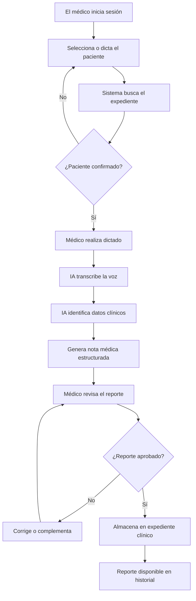
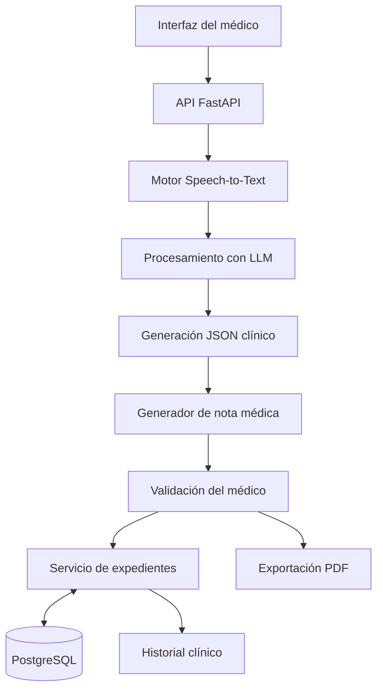

# MedVox
## Asistente Inteligente de Documentación Médica mediante Inteligencia Artificial

**Proyecto para Hackatón**

**Categoría:** Inteligencia Artificial aplicada a la salud  
**Tipo de solución:** Asistente de documentación clínica y gestión de expedientes electrónicos  
**Estado:** Propuesta inicial / MVP

---

## 1. Descripción general del proyecto

**MedVox** es un asistente basado en inteligencia artificial diseñado para automatizar la elaboración de reportes médicos y facilitar la actualización de expedientes clínicos mediante comandos de voz.

La solución busca que los profesionales de la salud puedan documentar una consulta médica sin necesidad de escribir manualmente toda la información.

A través del reconocimiento de voz y el procesamiento del lenguaje natural, el sistema interpreta lo expresado por el médico, organiza los datos clínicos, genera un reporte estructurado y prepara su almacenamiento en el expediente electrónico del paciente correspondiente.

El médico conserva el control del proceso mediante la revisión, corrección y aprobación de cada documento generado.

## 2. Problemática

En la práctica médica, los profesionales de la salud deben dedicar parte de su jornada a actividades administrativas relacionadas con la documentación clínica.

Entre estas actividades se encuentran:

- Redacción de notas médicas.
- Elaboración de reportes de consulta.
- Registro de síntomas y signos clínicos.
- Documentación de diagnósticos y tratamientos.
- Actualización de expedientes médicos.
- Consulta y organización del historial clínico de cada paciente.

Estas tareas pueden incrementar la carga administrativa, reducir el tiempo disponible para la atención de pacientes y generar errores de captura.

### Problema principal

**¿Cómo podemos reducir el tiempo que los médicos dedican a documentar consultas y actualizar expedientes clínicos sin comprometer la precisión, seguridad y calidad de la información médica?**

## 3. Solución propuesta

Desarrollar un asistente de inteligencia artificial que permita a los médicos generar documentación clínica mediante lenguaje natural hablado.

El sistema deberá ser capaz de:

1. Escuchar y transcribir el dictado del médico.
2. Identificar y estructurar la información clínica relevante.
3. Generar automáticamente una nota médica siguiendo un formato establecido.
4. Reconocer el nombre del paciente mencionado.
5. Buscar el expediente electrónico correspondiente.
6. Confirmar la identidad del paciente mediante información adicional.
7. Permitir al médico revisar y modificar el documento.
8. Almacenar la nota aprobada en el historial clínico del paciente.

La finalidad es convertir un proceso principalmente manual en un flujo asistido por inteligencia artificial.

## 4. Funcionamiento del sistema

### Etapa 1. Captura de voz

El médico activa el micrófono de la aplicación y comienza a dictar la información correspondiente a una consulta.

**Ejemplo:**

> Estoy atendiendo a Juan Pérez. El paciente presenta fiebre desde hace dos días, dolor de garganta y malestar general. Refiere que los síntomas comenzaron el lunes. Se encuentra consciente y orientado.

### Etapa 2. Procesamiento mediante IA

La aplicación convierte la voz en texto utilizando un modelo de reconocimiento de voz.

Posteriormente, un modelo de lenguaje identifica los elementos clínicos relevantes:

- Nombre del paciente.
- Motivo de consulta.
- Antecedentes mencionados.
- Síntomas.
- Signos y hallazgos.
- Diagnóstico, cuando sea expresado por el médico.
- Tratamiento e indicaciones médicas.

La IA organiza los datos sin inventar información que no haya sido proporcionada.

### Etapa 3. Generación del reporte médico

El sistema genera una nota clínica estructurada.

**Ejemplo de reporte:**

**NOTA MÉDICA**

**Paciente:** Juan Pérez  
**Fecha:** Generada automáticamente  
**Médico responsable:** Usuario autenticado

**Motivo de consulta:**  
Fiebre y dolor de garganta.

**Padecimiento actual:**  
Paciente que refiere fiebre de dos días de evolución, acompañada de dolor de garganta y malestar general. Indica que los síntomas comenzaron el lunes.

**Exploración física:**  
Paciente consciente y orientado, según la información proporcionada.

**Diagnóstico:**  
Pendiente de valoración y registro por el médico.

**Plan de tratamiento:**  
Pendiente de indicaciones médicas.

**Estado del documento:**  
Pendiente de revisión y autorización.

### Etapa 4. Identificación del paciente

La IA detecta el nombre del paciente mencionado durante el dictado y realiza una búsqueda en la base de datos.

El sistema muestra las coincidencias encontradas y solicita confirmar la identidad utilizando un identificador adicional, como el número de expediente o la fecha de nacimiento.

Esto evita que un reporte sea asociado accidentalmente con un paciente incorrecto.

### Etapa 5. Revisión y autorización

Antes de guardar el documento, el médico puede:

- Leer el reporte generado.
- Corregir errores de transcripción.
- Añadir información.
- Modificar la estructura.
- Confirmar el expediente seleccionado.
- Aprobar el documento final.

La IA no sustituye el juicio clínico del profesional de la salud.

### Etapa 6. Actualización del expediente

Una vez aprobado, el sistema almacena el reporte en el expediente electrónico del paciente.

Cada registro puede incluir:

- Identificador del paciente.
- Identificador del médico.
- Fecha y hora de la consulta.
- Tipo de reporte.
- Contenido de la nota médica.
- Estado de autorización.
- Historial de modificaciones.

## 5. Flujo general de la aplicación

## 6. Funcionalidades principales

### 6.1. Transcripción médica inteligente

Permitir que el médico dicte información clínica en lenguaje natural.

El reconocimiento de voz debe contemplar terminología médica y permitir corregir palabras interpretadas incorrectamente.

### 6.2. Generación automática de reportes

Transformar el dictado en documentos clínicos estructurados.

Entre los formatos que podría soportar el sistema se encuentran:

- Notas de consulta.
- Notas de evolución.
- Notas de seguimiento.
- Reportes de valoración.
- Formato SOAP (Subjetivo, Objetivo, Análisis y Plan).

### 6.3. Identificación y vinculación de pacientes

Detectar los datos de identificación mencionados por el médico, buscar coincidencias y asociar el reporte con el expediente correcto después de su confirmación.

### 6.4. Expediente clínico electrónico

Permitir consultar y organizar los reportes médicos de cada paciente.

Cada expediente incluirá un historial cronológico de documentos y consultas.

### 6.5. Consulta del expediente mediante lenguaje natural

Como funcionalidad avanzada, el médico podrá realizar preguntas como:

> ¿Cuáles son los antecedentes médicos registrados de Juan Pérez?

El sistema recuperará únicamente la información autorizada disponible en el expediente y generará una respuesta fundamentada en dichos registros.

## 7. Arquitectura tecnológica propuesta

| Componente | Tecnología | Función |
|---|---|---|
| Frontend | React o HTML, CSS y JavaScript | Interfaz para médicos |
| Backend | Python + FastAPI | Procesamiento y APIs |
| Reconocimiento de voz | Whisper o servicio Speech-to-Text | Conversión de voz a texto |
| Inteligencia artificial | LLM con salida JSON estructurada | Extracción de información y generación de notas |
| Base de datos | PostgreSQL | Almacenamiento de pacientes y reportes |
| Documentos | Plantillas y generación PDF | Exportación de notas médicas |
| Autenticación | JWT y control de roles | Acceso autorizado |
| Integración clínica futura | HL7 FHIR | Interoperabilidad con sistemas clínicos |

### Arquitectura conceptual

## 8. Modelo de datos inicial

### Tabla: Pacientes

| Campo | Descripción |
|---|---|
| id_paciente | Identificador único |
| nombre_completo | Nombre del paciente |
| fecha_nacimiento | Fecha de nacimiento |
| numero_expediente | Identificador clínico |
| fecha_registro | Fecha de creación |

### Tabla: Médicos

| Campo | Descripción |
|---|---|
| id_medico | Identificador único |
| nombre_completo | Nombre del profesional |
| cedula_profesional | Identificador profesional |
| especialidad | Especialidad médica |
| usuario | Cuenta de acceso |

### Tabla: Reportes médicos

| Campo | Descripción |
|---|---|
| id_reporte | Identificador del reporte |
| id_paciente | Paciente asociado |
| id_medico | Médico responsable |
| fecha_consulta | Fecha de atención |
| tipo_reporte | Clasificación del documento |
| transcripcion | Texto del dictado |
| contenido_estructurado | Información clínica organizada |
| estado | Borrador, aprobado o corregido |
| fecha_creacion | Fecha de creación |
| fecha_autorizacion | Fecha de aprobación |

## 9. Producto mínimo viable (MVP)

Para el hackatón, el objetivo será construir una versión funcional que demuestre el proceso completo.

### Alcance inicial

**Módulo 1. Registro de pacientes**

- Crear pacientes ficticios.
- Almacenar datos básicos.
- Consultar expedientes disponibles.

**Módulo 2. Dictado médico**

- Activar micrófono.
- Capturar audio.
- Transcribir el contenido.

**Módulo 3. Procesamiento con IA**

- Identificar información clínica.
- Convertirla en datos estructurados.
- Generar automáticamente la nota médica.

**Módulo 4. Gestión de reportes**

- Visualizar la nota.
- Permitir modificaciones.
- Aprobar el documento.

**Módulo 5. Expediente electrónico**

- Buscar y confirmar al paciente.
- Guardar el reporte aprobado.
- Consultar notas anteriores.

### Resultado esperado del MVP

Demostrar que un médico puede dictar una consulta, generar una nota estructurada con IA y almacenarla en el expediente correcto sin redactarla manualmente desde cero.

## 10. Funcionalidades futuras

Una vez validado el MVP, podrían incorporarse nuevas capacidades.

### Asistente durante consultas médicas

Con consentimiento y controles de privacidad adecuados, el sistema podría escuchar una conversación entre médico y paciente, identificar información relevante y preparar una nota para revisión.

### Consultas inteligentes

El médico podría consultar antecedentes, notas anteriores o tratamientos registrados mediante preguntas en lenguaje natural.

### Plantillas por especialidad

Generación de formatos adaptados a medicina general, pediatría, cardiología, urgencias y otras especialidades.

### Integración con sistemas hospitalarios

Conectividad mediante estándares como HL7 FHIR para permitir el intercambio de información con expedientes clínicos electrónicos compatibles.

### Indicadores operativos

Medición de:

- Tiempo promedio de documentación.
- Número de reportes generados.
- Correcciones realizadas.
- Tiempo de revisión médica.
- Productividad administrativa.

## 11. Seguridad y consideraciones éticas

Al tratarse de información médica, la seguridad constituye un requisito fundamental.

El sistema deberá contemplar:

- Protección de datos personales sensibles.
- Autenticación y autorización de usuarios.
- Cifrado de información en tránsito y almacenamiento.
- Registro de accesos y modificaciones.
- Confirmación de identidad del paciente.
- Revisión obligatoria por el médico.
- Prevención de contenido clínico inventado por la IA.
- Controles sobre almacenamiento y tratamiento de grabaciones.
- Cumplimiento de la normativa aplicable, incluyendo las disposiciones mexicanas sobre expedientes clínicos y protección de datos personales.

Durante el hackatón se utilizarán exclusivamente datos ficticios o sintéticos.

La herramienta estará diseñada como asistente de documentación, no como sistema autónomo de diagnóstico ni de prescripción.

## 12. Propuesta de valor

MedVox busca transformar la manera en que los profesionales de la salud documentan sus consultas.

### Beneficios potenciales

**Para médicos:**

- Menos tiempo de captura manual.
- Documentación más organizada.
- Reducción de tareas administrativas repetitivas.
- Mayor facilidad para consultar expedientes.

**Para instituciones médicas:**

- Estandarización de reportes.
- Mejor organización de información clínica.
- Mayor trazabilidad de documentos.
- Potencial mejora en eficiencia operativa.

**Para pacientes:**

- Posibilidad de que el médico dedique más atención a la consulta.
- Mayor continuidad de la información documentada.
- Historial clínico organizado y disponible para profesionales autorizados.

Estos beneficios deberán validarse mediante pruebas con usuarios y métricas comparativas.

## 13. Diferenciador del proyecto

La propuesta no consiste únicamente en transcribir audio.

La innovación está en integrar varias capacidades en un mismo flujo de trabajo:

**Voz → Comprensión del contenido → Estructuración clínica → Validación médica → Vinculación con el paciente → Actualización del expediente.**

Mientras un transcriptor tradicional convierte palabras habladas en texto, MedVox busca convertir el dictado del médico en documentación clínica organizada y lista para incorporarse al expediente después de ser autorizada.

## 14. Indicadores de éxito del hackatón

Para evaluar el prototipo, proponemos medir:

| Indicador | Objetivo |
|---|---|
| Flujo completo | Dictar, generar, aprobar y guardar una nota |
| Precisión de transcripción | Medir errores frente a una transcripción de referencia |
| Calidad del reporte | Verificar campos completos y fidelidad al dictado |
| Identificación de paciente | Confirmar vinculación correcta mediante identificadores |
| Tiempo de documentación | Comparar dictado asistido contra captura manual |
| Seguridad | Impedir guardar notas sin autorización médica |

Los valores y mejoras reales se determinarán mediante pruebas controladas.

## 15. Pitch del proyecto

**MedVox: menos tiempo escribiendo, más tiempo atendiendo.**

> Imaginemos a un médico que termina de atender a su paciente y, en lugar de dedicar varios minutos a redactar una nota clínica, simplemente habla.
>
> Nuestro sistema escucha su dictado, identifica la información relevante, genera un reporte médico estructurado y prepara su incorporación al expediente electrónico del paciente.
>
> El profesional únicamente debe revisar, corregir si es necesario y autorizar el documento.
>
> Esto es MedVox: un asistente de inteligencia artificial que busca reducir la carga administrativa del personal médico, facilitar la documentación clínica y permitir que los profesionales de la salud concentren más tiempo en lo más importante: sus pacientes.

---

## 16. Conclusión

**MedVox** propone utilizar inteligencia artificial para simplificar uno de los procesos administrativos más recurrentes en los servicios de salud: la documentación médica.

El proyecto combina reconocimiento de voz, procesamiento del lenguaje natural, generación de documentos y gestión de expedientes clínicos en una única solución.

Para el hackatón se desarrollará un prototipo que demuestre la viabilidad del flujo completo, desde el dictado de una consulta hasta el almacenamiento autorizado de la nota en el expediente del paciente.

**Objetivo final:** Que los médicos puedan documentar sus consultas hablando, mientras la inteligencia artificial se encarga de preparar, estructurar y organizar la información de manera segura, verificable y eficiente.