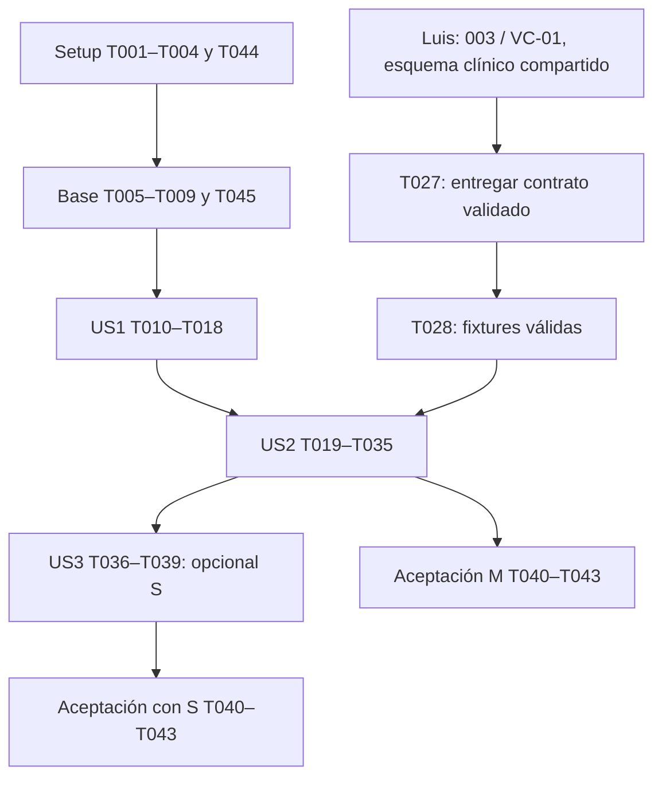

# Tasks: Acceso del médico y gestión de pacientes — por miembro

**Feature**: `001-acceso-pacientes`. **Branch**: `work`.

Vista generada por `python3 scripts/sync-team-tasks.py`. Las fuentes editables
son los archivos individuales enlazados abajo. Actualiza allí las casillas y
regenera esta vista; no mantengas estados distintos en ambas ubicaciones.

**Input**: [spec.md](spec.md), [plan.md](plan.md), [research.md](research.md),
[data-model.md](data-model.md), [API](contracts/openapi.json),
[interfaz](contracts/ui.md) y [quickstart.md](quickstart.md).

US1/US2 son P1/M; US3 es P2/S. `[P]` permite trabajo en paralelo una vez
resueltos los prerrequisitos; cada tarea tiene un responsable único. Las rutas
de aplicación indican los entregables; las casillas reflejan su estado verificado.

| Miembro | Área | Tareas | Completadas | Fuente editable |
|---|---|---|---|---|
| German | Frontend e integración | 21 | 0 | [german.md](tasks/german.md) |
| Jeroben | Backend e infraestructura | 23 | 22 | [jeroben.md](tasks/jeroben.md) |
| Luis | Contrato clínico compartido | 1 | 0 | [luis.md](tasks/luis.md) |

**Total**: 45 tareas. T001–T043 conservan sus IDs; T044/T045
separan configuración y runners frontend de tareas antes mixtas.

## German

Fuente: [tasks/german.md](tasks/german.md).

### Phase 1: Setup — estructura y dependencias

- [ ] T002 [P] Inicializar React/TypeScript/Vite en `frontend/package.json`, `frontend/package-lock.json` y `frontend/src/main.tsx`; usar Node 22 LTS >=22.12, React Router, TanStack Query, Tailwind/shadcn y Lucide; definir scripts dev, test, build y test:e2e sin añadir una raíz npm de monorepo.

- [ ] T044 Añadir `frontend/.env.example` con VITE_API_URL público, sin secretos; entregar a Jeroben los orígenes frontend exactos y exclusiones node_modules/build para T004/T005. Conservar variables locales existentes y no editar simultáneamente `.gitignore` o `docs/DESARROLLO.md`, cuyo responsable es Jeroben.

### Phase 2: Foundational — base común

- [ ] T007 Crear el cliente HTTP en `frontend/src/api/client.ts` y tipos de error en `frontend/src/api/types.ts`, tomando VITE_API_URL; permitir inyectar token y callback de 401, distinguir fallo de red de lista vacía y no reintentar automáticamente escrituras.

- [ ] T008 Incorporar tokens del design system y estilos base en `frontend/src/styles/tokens.css` y `frontend/src/index.css`; configurar proveedores de consulta/router en `frontend/src/app/providers.tsx`, con tipografía, foco visible y componentes accesibles de shadcn sin exponer claves de servicios externos.

- [ ] T045 Configurar Vitest/Testing Library en `frontend/vitest.config.ts` y Playwright en `frontend/playwright.config.ts`, fijar herramientas y scripts en `frontend/package.json` y `frontend/package-lock.json`; usar API real y base de demo aislada para E2E, con URL/fixtures coordinadas con Jeroben en T009; no aceptar cero tests como éxito.

### Phase 3: User Story 1 — Acceder como médico (P1 / M)

- [ ] T011 [P] [US1] Escribir pruebas de login, rutas protegidas y salida en `frontend/src/features/auth/auth.test.tsx`: token `medvox:token`, claves `medvox:borrador:`/`medvox:correccion:`, cancelar conserva todo, confirmar elimina trabajo/token/caché, 401 no descarta borradores y no duplica escrituras.

- [ ] T015 [US1] Implementar estado de sesión y conexión con cliente HTTP en `frontend/src/features/auth/session.ts` y `frontend/src/api/auth.ts`; restaurar token, consumir me y limpiar token/cachés ante 401 manteniendo borradores locales; no presentar salida local como revocación del JWT emitido.

- [ ] T016 [US1] Crear `/login`, protección de rutas y layout autenticado en `frontend/src/pages/LoginPage.tsx`, `frontend/src/components/AppLayout.tsx` y `frontend/src/app/router.tsx`; mostrar médico, cédula, Cerrar sesión y Datos ficticios; permitir pegar contraseñas y mostrar errores accesibles; usar página de destino provisional sin fingir lista de pacientes disponible.

- [ ] T017 [US1] Implementar confirmación Seguir trabajando / Descartar y salir en `frontend/src/components/LogoutDialog.tsx` y `frontend/src/features/auth/logout.ts`; eliminar solo claves de trabajo de MedVox al confirmar, token y cachés, sin modificar notas del servidor; integrar con `frontend/src/components/AppLayout.tsx`.

- [ ] T018 [US1] Ejecutar tests de US1 y agregar recorrido integrado con API real en `frontend/e2e/auth.spec.ts`; cubrir acceso válido, inválido, teclado y salida con borrador sintético local; registrar comandos/conteos/resultados en `specs/001-acceso-pacientes/validation/german.md`, distinguiendo lo ejecutado de lo pendiente. German escribe las pruebas frontend; Jeroben proporciona API, base de pruebas y resultados de suites backend. La tarea se completa solo con la evidencia de ambas partes requerida por el escenario.

### Phase 4: User Story 2 — Encontrar y registrar al paciente correcto (P1 / M)

- [ ] T022 [P] [US2] Escribir pruebas de interfaz en `frontend/src/features/pacientes/pacientes.test.tsx`: búsquedas fuera de orden, errores distintos de vacío, aviso de coincidencias, abrir existente/confirmar nuevo, registro mínimo y presentación de nacimiento sin desplazamiento UTC; escribir pruebas de lectura/selección de versiones en `frontend/src/features/notas/nota.test.tsx`.

- [ ] T030 [US2] Implementar nombres de cabecera, edad y fechas locales en `frontend/src/lib/formatos.ts`: APELLIDOS, Nombre(s), DD/mmm/AAAA, 24 h, edad en meses antes de 2 años/días antes de 1 mes; probar límites de cumpleaños/mes en `frontend/src/lib/formatos.test.ts` sin convertir nacimiento ISO mediante UTC.

- [ ] T031 [US2] Crear consumidores y tipos de pacientes/notas en `frontend/src/api/pacientes.ts`, `frontend/src/api/notas.ts` y `frontend/src/api/clinical-types.ts`, alineados con OpenAPI; usar query keys por paciente/nota y cancelación o descarte de respuestas antiguas; no añadir endpoints de duplicados ni autorización.

- [ ] T032 [US2] Crear lista/buscador y registro en `frontend/src/pages/PacientesPage.tsx` y `frontend/src/components/PacienteForm.tsx`; mínimos y límites idénticos al contrato, posibles duplicados combinados por id desde búsquedas nombre/fecha antes del POST, acciones Abrir expediente / No es ninguno: registrar nuevo, alta con número solo del servidor y estados carga/error/vacío accesibles.

- [ ] T033 [US2] Crear expediente, cabecera e historial en `frontend/src/pages/PacienteDetailPage.tsx`, `frontend/src/components/PacienteHeader.tsx` y `frontend/src/components/NotasHistory.tsx`; mostrar alergias, fecha, diagnóstico, médico, estado y versión, distinguir vacío de error y conservar contexto al navegar. Registrar rutas en `frontend/src/app/router.tsx`; Nueva consulta solo enlaza a 002 cuando la ruta exista, sin simular captura implementada.

- [ ] T034 [US2] Crear detalle y selector de versiones de solo lectura en `frontend/src/pages/NotaDetailPage.tsx` y `frontend/src/components/NotaReadOnly.tsx`; renderizar el formato completo de §7, no solo el resumen, mostrar origen/estados del contenido y autor/fecha/motivo por versión; usar la plantilla compartida sin inventar campos, sin edición/autorización/corrección de 004/005.

- [ ] T035 [US2] Completar tests de US2 y recorridos integrados en `frontend/e2e/pacientes.spec.ts` y `frontend/e2e/notas.spec.ts` con API/PostgreSQL reales; ejecutar cargar_demo dos veces y pruebas de concurrencia, contrato y lectura inmutable; registrar conteos/resultados y cualquier bloqueo de esquema en `specs/001-acceso-pacientes/validation/german.md`. No aceptar US2 completa si el historial solo funciona con mocks. German escribe las pruebas frontend; Jeroben proporciona API, base de pruebas y resultados de suites backend. La tarea se completa solo con la evidencia de ambas partes requerida por el escenario.

### Phase 5: User Story 3 — Corregir la ficha del paciente (P2 / S)

- [ ] T038 [US3] Reutilizar formulario para edición de ficha en `frontend/src/components/PacienteForm.tsx`, agregar PATCH en `frontend/src/api/pacientes.ts` e integrar acción en `frontend/src/pages/PacienteDetailPage.tsx`; invalidar cachés de ficha/lista tras éxito sin cambiar el contenido de versiones de notas ni abrir edición de identificación en la nota.

- [ ] T039 [US3] Verificar actualización de ficha, errores y expediente inmutable con tests de componente en `frontend/src/features/pacientes/editar-paciente.test.tsx` y E2E en `frontend/e2e/editar-paciente.spec.ts`; ejecutar backend S01 y registrar resultados en `specs/001-acceso-pacientes/validation/german.md`; si la mejora se difiere, reportarla pendiente sin bloquear aceptación M. German escribe las pruebas frontend; Jeroben proporciona API, base de pruebas y resultados de suites backend. La tarea se completa solo con la evidencia de ambas partes requerida por el escenario.

### Phase 6: Polish — aceptación transversal

- [ ] T042 Verificar WCAG 2.2 AA y presentación de flujos entregados con revisión manual y pruebas automatizadas en `frontend/e2e/accessibility.spec.ts`: teclado, foco/diálogos, contraste, etiquetas/errores, icono y texto además de color, español de México, fechas y Datos ficticios; no equiparar un análisis automático con conformidad completa.

- [ ] T043 Ejecutar la guía `specs/001-acceso-pacientes/quickstart.md` con backend, PostgreSQL y frontend reales: instalación reproducible, migraciones, carga idempotente, suites con conteos mayores que cero, build y E2E. Actualizar `specs/001-acceso-pacientes/validation/german.md`, `specs/001-acceso-pacientes/quickstart.md` y `README.md` con comandos/resultados, pendientes S y límites; no declarar 001 lista si falta lectura completa o comprobaciones requeridas. German coordina la ejecución con Jeroben y Luis, consolida sus evidencias sin cambiarlas en `specs/001-acceso-pacientes/validation.md` y recoge de Jeroben los cambios de documentación backend; no marca tareas ajenas ni omite bloqueos.

## Jeroben

Fuente: [tasks/jeroben.md](tasks/jeroben.md).

### Phase 1: Setup — estructura y dependencias

- [x] T001 Crear el esqueleto Django 5.2/Python 3.12 en `backend/manage.py`, `backend/medvox/` y apps `backend/cuentas/`, `backend/pacientes/`, `backend/notas/`; resolver dependencias del plan y fijar versiones compatibles en `backend/requirements.txt`, separando herramientas de prueba en `backend/requirements-dev.txt`.

- [x] T003 [P] Definir PostgreSQL 16 para desarrollo/pruebas en `compose.yaml`, con credenciales tomadas de variables locales, comprobación de salud y persistencia solo de la base; documentar acceso a unaccent y creación de base de tests en `docs/DESARROLLO.md`; no iniciar IA ni n8n para esta fase.

- [x] T004 Añadir variables backend sin valores secretos en `backend/.env.example` y exclusiones compartidas en `.gitignore`; documentar DATABASE_URL, DJANGO_SECRET_KEY, ALLOWED_HOSTS y CORS_ALLOWED_ORIGINS en `docs/DESARROLLO.md`, preservar archivos previos y distinguir HTTP local de HTTPS desplegado. Jeroben mantiene estos archivos compartidos; recibe de German las variables y orígenes frontend de T044.

### Phase 2: Foundational — base común

- [x] T005 Configurar PostgreSQL, apps, zona America/Mexico_City, idioma es-mx, JWT de acceso de 12 horas sin refresh y autenticación predeterminada en `backend/medvox/settings.py`; limitar CORS a orígenes exactos, manejar configuración por entorno y mantener logs sin tokens ni cuerpos clínicos.

- [x] T006 Definir errores `{error:{codigo,mensaje}}`, validación con faltantes/detalles, 404 uniforme y permiso de usuario activo con perfil médico en `backend/medvox/exceptions.py` y `backend/cuentas/permissions.py`; conectar el manejador en `backend/medvox/settings.py` y rutas sin slash final en `backend/medvox/urls.py`.

- [x] T009 Preparar descubrimiento de pruebas Django y validación de respuestas contra `specs/001-acceso-pacientes/contracts/openapi.json` en `backend/tests/contracts.py`; fijar herramientas en `backend/requirements-dev.txt`, usar PostgreSQL con base de pruebas aislada y evitar que cero tests cuente como éxito. Coordinar con German los datos de API necesarios para T045.

### Phase 3: User Story 1 — Acceder como médico (P1 / M)

- [x] T010 [P] [US1] Escribir pruebas de contrato/permisos para POST /api/auth/login y GET /api/auth/me en `backend/cuentas/tests/test_auth.py`: casos A01–A04, usuario inactivo, sin perfil, token expirado/alterado, access sin datos clínicos y nombres usuario/contrasena → access/medico; verificar fallos antes de la implementación de la historia.

- [x] T012 [US1] Crear Medico y migración inicial en `backend/cuentas/models.py` y `backend/cuentas/migrations/0001_initial.py`: usuario «OneToOne protegido frente a eliminación», nombre_completo «(200)», cedula_profesional «(20)», especialidad «(100), todos obligatorios»; conservar User estándar de Django y contraseña hasheada, sin registro público.

- [x] T013 [US1] Crear carga idempotente de los dos médicos de guía backend §9 en `backend/cuentas/demo.py` y el comando `backend/notas/management/commands/cargar_demo.py`; en esta etapa cargar solo médicos, sin duplicar ni sobrescribir usuarios existentes, sin reset destructivo y sin registrar contraseñas.

- [x] T014 [US1] Implementar login/me en `backend/cuentas/serializers.py`, `backend/cuentas/views.py` y `backend/cuentas/urls.py`; credenciales inválidas/inactivo producen 401, usuario sin perfil no recibe acceso clínico, respuesta devuelve identidad profesional según OpenAPI; no añadir refresh ni logout remoto.

### Phase 4: User Story 2 — Encontrar y registrar al paciente correcto (P1 / M)

- [x] T019 [P] [US2] Escribir pruebas de búsqueda, alta, detalle y permisos en `backend/pacientes/tests/test_api.py`, casos P01–P05 y N02: acentos/mayúsculas, expediente, fechas ISO/DD/MM/AAAA, búsqueda vacía, mínimos, nacimiento futuro, enum sexo, campos internos rechazados y ausencia de altas al fallar; verificar respuestas contra OpenAPI.

- [x] T020 [P] [US2] Escribir pruebas de historial y detalle en `backend/notas/tests/test_read_api.py`, casos N01–N03: diagnóstico de versión vigente, orden fecha/hora descendente con desempate id, versiones descendentes, contenido/autor/fecha/motivo intactos, 404, permisos y ausencia de métodos de escritura de notas en 001.

- [x] T021 [P] [US2] Escribir TransactionTestCase sobre PostgreSQL en `backend/pacientes/tests/test_expedientes.py`: altas simultáneas con expedientes distintos, restricción UNIQUE, inicio en 48300 o superior al importado, inicialización idempotente sin rebobinar, formato 0000-0000 y rechazo de desbordamiento; no exigir ausencia de huecos.

- [x] T023 [US2] Crear Paciente y migración en `backend/pacientes/models.py` y `backend/pacientes/migrations/0001_initial.py`: numero_expediente «Único, formato `0000-0000`, inmutable»; nombres «Texto requerido, máximo 100; recortar espacios externos»; apellido_paterno «Texto requerido, máximo 100»; apellido_materno «Máximo 100; ausencia normalizada a cadena vacía»; fecha_nacimiento «Fecha válida, no futura»; sexo «mujer / hombre / no_especificado»; alergias «Texto requerido no vacío; Sin alergias conocidas se expresa explícito»; tipo_sangre «Máximo 3, vacío permitido»; telefono «Máximo 20, opcional; null de entrada se normaliza a vacío interno»; creado_por «Médico de la sesión, relación protegida», creado_en «Fecha/hora del servidor»; memoria_ref «Opcional, reservado a 006», no expuesto; id solo lectura y edad no persistida.

- [x] T024 [US2] Crear unaccent y secuencia de expediente en `backend/pacientes/migrations/0002_busqueda_expediente.py` y asignación transaccional en `backend/pacientes/services.py`; respetar inicio 48300, máximo importado y secuencia no rebobinada; no usar max+1 sin bloqueo; completar inicialización antes de aceptar altas.

- [x] T025 [US2] Implementar GET/POST /api/pacientes y GET /api/pacientes/{id} en `backend/pacientes/serializers.py`, `backend/pacientes/views.py` y `backend/pacientes/urls.py`; unaccent en nombres/apellidos, expediente y fecha exacta cuando q sea fecha, sin paginación; rechazo explícito de campos fuera de contrato, creado_por de sesión y total_notas/ultima_consulta derivados (0/null sin notas). PATCH sigue pendiente de US3.

- [x] T026 [US2] Crear Plantilla/Nota/VersionNota y migración en `backend/notas/models.py` y `backend/notas/migrations/0001_initial.py`: Plantilla con «unicidad de clave/versión»; Nota con relaciones protegidas, tipo «primera_vez/seguimiento», modo «dictado/consulta», estado «autorizada/corregida» y versión vigente; VersionNota con «número positivo», «transcripción opcional», «Unicidad de nota/número; versiones inmutables» y «motivo es obligatorio desde la versión 2»; incluir contenido según plantilla, consentimiento, autor y fechas, sin tabla de borradores/audio.

- [x] T028 [US2] Extender `backend/notas/management/commands/cargar_demo.py` y agregar fixtures sintéticas en `backend/notas/fixtures/demo/` con los seis pacientes de guía backend §9 y sus notas previas válidas contra el esquema de 003; conservar alergia a penicilina, autores y fechas documentadas, incluir una nota corregida de prueba con dos versiones; validar todo antes de escribir, sin duplicar ni sobrescribir datos, y ajustar secuencia solo hacia delante. Depende del esquema compartido verificado.

- [x] T029 [US2] Implementar GET /api/pacientes/{id}/notas y GET /api/notas/{id} en `backend/notas/serializers.py`, `backend/notas/views.py` y `backend/notas/urls.py`; incluir plantilla, paciente, médico y todas las versiones según OpenAPI, diagnóstico vigente/null, orden estable y sin audio; evitar consultas N+1 y mantener métodos de escritura deshabilitados.

### Phase 5: User Story 3 — Corregir la ficha del paciente (P2 / S)

- [x] T036 [P] [US3] Escribir pruebas PATCH y autorización en `backend/pacientes/tests/test_patch.py`: mínimos/límites/enum de Paciente, cambio de ficha, rechazo de numero_expediente/creado_por/contadores, ausencia de mutación en contenido histórico y 401/403/404 según contrato; caso S01 del quickstart.

- [x] T037 [US3] Implementar PATCH /api/pacientes/{id} usando campos permitidos y validación parcial en `backend/pacientes/serializers.py` y `backend/pacientes/views.py`; mantener «numero_expediente: Único, formato `0000-0000`, inmutable», autoría y fechas internas solo lectura; no agregar editor de tipo_sangre, memoria_ref ni propiedades derivadas.

### Phase 6: Polish — aceptación transversal

- [x] T040 Verificar todos los endpoints implementados de `specs/001-acceso-pacientes/contracts/openapi.json` con pruebas transversales en `backend/tests/test_contract_security.py`: status/cuerpos, token inválido y permisos médicos, datos internos rechazados, 404 y métodos clínicos de escritura ausentes; si PATCH S no se entrega, registrar explícitamente esa excepción de alcance.

- [ ] T041 Validar configuración de despliegue HTTPS/CORS y ausencia de tokens/cuerpos clínicos en logs; actualizar `docs/DESARROLLO.md` y `backend/medvox/settings.py` con configuración segura por entorno, sin elegir ni publicar proveedor no acordado; distinguir comprobación local de verificación HTTPS real y registrar lo que falte en `specs/001-acceso-pacientes/validation/jeroben.md`.

## Luis

Fuente: [tasks/luis.md](tasks/luis.md).

### Phase 4: User Story 2 — Encontrar y registrar al paciente correcto (P1 / M)

- [ ] T027 [US2] Entregar o reutilizar desde 003/VC-01 el contrato compartido en `ia/esquemas/formato_clinico_general_v1_1.json` y ejemplos sintéticos en `ia/esquemas/ejemplos/`, conforme a REQUERIMIENTOS §7 y la guía IA §5; validar esquema y ejemplos y coordinar con German/Jeroben claves, campos y versión. No crear un esquema reducido ni implementar aquí transcripción/LLM. Comunicar ruta, versión y resultado de validación para desbloquear T028 y T034; si la entrega sigue pendiente, mantener esta casilla abierta y registrar el bloqueo en `specs/001-acceso-pacientes/validation/luis.md`. El contrato pertenece a 003 aunque se registre como dependencia compartida de 001.

## Coordinación de tareas — acceso y pacientes

Las 45 tareas de esta funcionalidad tienen un responsable único. Las 43 originales
conservan sus IDs; T044 separa la configuración frontend de T004 y T045 separa los
runners frontend de T009. El estado actual está en las listas individuales;
Jeroben tiene 22 tareas completadas y solo T041 pendiente. German y Luis conservan sus tareas.

| Miembro | Fuente editable | Responsabilidad |
|---|---|---|
| German (A) | [german.md](tasks/german.md) | Frontend y coordinación E2E |
| Jeroben (B) | [jeroben.md](tasks/jeroben.md) | Backend, base de datos e infraestructura |
| Luis (C) | [luis.md](tasks/luis.md) | Contrato clínico compartido 003/VC-01 |

## Reglas de trabajo y entregas

- Trabajar en `frontend/`, `backend/` e `ia/` del mismo repositorio.
- Cada responsable actualiza sus casillas en su archivo. `tasks.md` es una vista
  generada compatible con lectura de Spec Kit; regenerar con
  `python3 scripts/sync-team-tasks.py` y comprobar con `--check`.
- Los IDs no indican el orden por sí solos: T044 pertenece a Setup y T045 a base
  común. Mantener prioridades P1/M (US1/US2) y P2/S (US3).
- Jeroben mantiene `.gitignore`, `compose.yaml` y `docs/DESARROLLO.md`; German
  le entrega la configuración/orígenes frontend. German mantiene package.json,
  router y configuración frontend; Luis mantiene esquema y ejemplos compartidos.
- Cada miembro registra evidencia en `specs/001-acceso-pacientes/validation/<nombre>.md`.
  German consolida en `validation.md` al cerrar T043; no escribir a la vez en
  el mismo informe ni marcar tareas de otro responsable.
- German coordina T018/T035/T039/T043; Jeroben ejecuta y entrega resultados backend.
  Tener un responsable único no elimina la colaboración requerida ni acredita pruebas.
- Luis entrega a Jeroben y German esquema v1.1 y ejemplos validados en T027.
  Jeroben entrega API, usuarios y datos ficticios; German entrega integración,
  resultados de build/E2E y orígenes para CORS. No cambiar claves o contratos sin
  comunicarlo a sus consumidores.

## Criterios por fase

## Phase 1: Setup — estructura y dependencias

Crear backend y frontend en este mismo checkout, con dependencias reproducibles por componente. No crear worktrees ni otro repositorio.

**Checkpoint**: Completar y validar esta fase antes de aceptar los incrementos que dependen de ella.

## Phase 2: Foundational — base común

Completar esta fase antes de las historias. No introducir modelos de borrador/audio, endpoints clínicos de escritura ni nuevas dependencias de proveedores IA.

**Checkpoint**: Completar y validar esta fase antes de aceptar los incrementos que dependen de ella.

## Phase 3: User Story 1 — Acceder como médico (P1 / M)

Objetivo: iniciar sesión, consultar identidad y salir de forma explícita. Prueba independiente: con médicos ficticios, login/me válidos, rechazo de credenciales y sesiones inválidas, cancelación o confirmación de salida con trabajo local. No depende de los modelos de pacientes ni de IA.

**Checkpoint**: US1 demostrable sin pacientes ni IA; los tests anteriores pasan y la salida no afirma revocar JWT.

## Phase 4: User Story 2 — Encontrar y registrar al paciente correcto (P1 / M)

Objetivo: buscar/registrar pacientes y consultar expediente con versiones de solo lectura. Prueba independiente: sesión autenticada preparada, seis pacientes ficticios, búsqueda García/garcia y fechas, aviso de coincidencias, alta con expediente único, historial y nota íntegra. La lectura completa requiere el esquema compartido de 003/VC-01, no el pipeline IA ni las escrituras de 004/005.

**Checkpoint**: US2 demostrable con API real, pacientes y notas válidas; dependencia compartida resuelta antes de aceptar la historia.

## Phase 5: User Story 3 — Corregir la ficha del paciente (P2 / S)

Objetivo: editar ficha sin alterar el expediente ni las versiones de notas. Mejora opcional después del alcance M. Prueba independiente: paciente y sesión preparados; PATCH permitido actualiza ficha, expediente queda inmutable y el lector de notas no habilita editar identificación dentro de su contenido.

**Checkpoint**: US3 verificada como mejora S o explícitamente diferida; no convierte S en obligación M.

## Phase 6: Polish — aceptación transversal

Aplicar al alcance M y, si se entrega, a US3. Las casillas se actualizan solo con evidencia del responsable; no acreditar integración frontend por haber validado la API.

**Checkpoint**: Completar y validar esta fase antes de aceptar los incrementos que dependen de ella.

## Dependencies & Execution Order

### Dependencias de fases

- Setup T001–T004 + T044 → base común T005–T009 + T045 → US1 T010–T018.
- US1 → US2 T019–T035 para demostración integrada con sesión real.
- US2 → US3 T036–T039, solo si se entrega la mejora S.
- Aceptación transversal T040–T043 después de US1/US2; incorporar US3 si se decide entregarla.

### Dependencias internas y frontera con 003

- T001 antes de T005/T006/T009 backend; T002 antes de T007/T008/T045 frontend. T044 coordina configuración frontend con T004 antes de pruebas integradas.
  T003/T004 deben estar disponibles para ejecutar pruebas reales de PostgreSQL.
- US1: T010/T011 pueden redactarse simultáneamente; T012 → T013/T014;
  T015 → T016 → T017; T018 requiere ambas partes implementadas.
- US2: T019–T022 son pruebas en archivos distintos. T023 → T024; T025 se
  escribe tras T023, y se completa con derivados tras T026/T029. T026 necesita
  el modelo Paciente. T027 bloquea T028, la validación de contenido completo de
  T034 y la aceptación T035. T029 depende de T026; T030/T031 preparan T032–T034.
  T032 puede avanzar y validarse con historial vacío antes de resolver T027.
- Luis es responsable de T027: entrega el contrato compartido de 003/VC-01.
  No requiere tener listo el pipeline IA para desbloquear el historial. German y
  Jeroben revisan claves y ejemplos antes de consumirlos. Si falta el esquema,
  el trabajo que requiera ese contrato permanece bloqueado. Actualización: el esquema
  llegó en main y fue verificado; Jeroben completó T028. La aceptación frontend
  T034/T035 conserva su propio estado y no se marca por la validación backend.
- US3: T036 → T037/T038 → T039. T037 y T038 afectan archivos de US2, por lo
  que no deben editarse a la vez que esa historia en curso.
- Las rutas compartidas settings.py, router.tsx, package.json, serializers.py,
  cargar_demo.py y validation.md requieren edición serializada aunque otras tareas
  trabajen en paralelo. Los prerrequisitos de esta sección prevalecen sobre el orden
  numérico cuando una tarea permite avanzar un componente independiente.

### Ejemplos de paralelismo

- Setup: T002 (frontend) y T003 (PostgreSQL) pueden avanzar mientras T001 prepara backend.
- US1, tras la base común: redactar T010 (pruebas backend) y T011 (pruebas de sesión frontend)
  en paralelo. Tras T012/T014 y T015, API y pantalla pueden avanzar en archivos separados.
- US2, tras US1: redactar T019, T020, T021 y T022 en paralelo. No ejecutar las pruebas
  de concurrencia hasta tener PostgreSQL, migraciones y secuencia. Después de los modelos,
  T029 (lectura API) y T030 (formatos frontend) no comparten archivos.
- US3: T036 puede redactarse mientras se prepara la revisión frontend de la historia;
  T037 y T038 pueden desarrollarse en paralelo una vez estabilizada US2 y definidos
  los tests, porque backend y frontend no comparten archivos.

## Trazabilidad y validación por historia

| Origen | Historia / tareas principales | Evidencia prevista |
|---|---|---|
| RF-01 / FR-001 | US1 T010, T012–T016, T018 | A01–A04, login/me y perfil real |
| RF-02 / FR-002 | US1 T011, T015, T017–T018 | Cancelar conserva; confirmar elimina trabajo local; 401 no descarta |
| RF-03 / FR-003 | US2 T019, T024–T025, T030–T032, T035 | P01/P02; acentos, expediente y fechas |
| RF-04 / FR-004 | US2 T019, T021–T025, T031–T032, T035 | P03–P06; mínimos, coincidencias, autoría y concurrencia |
| RF-05 / FR-005 | US2 T027–T028, T035 | P07; 6 pacientes ficticios y alergia a penicilina |
| RF-06 / FR-006 | US2 T020, T026, T028–T029, T033, T035 | N01; una fila por nota, diagnóstico vigente y orden |
| RF-07 / FR-007 | US2 T020, T026–T029, T034–T035 | N01–N03; detalle completo y versiones inmutables |
| RF-08 / FR-008 (S) | US3 T036–T039 | S01; ficha editable, expediente y contenido histórico intactos |
| RNF-01 | T013, T028, T016, T042 | Datos ficticios visibles y fixtures coherentes |
| RNF-03 | T004–T005, T041 | HTTPS y CORS por entorno, diferenciando local/desplegado |
| RNF-04 / SC-004 | T005–T006, US1, T040 | Autenticación en todas las rutas disponibles, sin credenciales expuestas |
| RNF-08 | T008, T030, T042 | Revisión de teclado, foco, contraste y español de México |
| SC-001 | T018, T035 | Acceso → búsqueda → expediente con API real |
| SC-002 | T028, T035 | 6 pacientes, notas previas y alergia de demo |
| SC-003 | T019, T032, T035 | Igualdad de búsqueda García/garcia |
| CA-08 | T040 parcial en 001; completa en 004 | POST /api/notas se verifica cuando se implemente; no inventar endpoint aquí |

## Implementation Strategy

1. Completar Setup y base común; demostrar US1 como primer incremento útil.
2. Entregar búsqueda y alta de US2 sin esperar el pipeline de audio; preparar el
   contrato de esquema compartido 003/VC-01 para notas y versiones de ejemplo.
3. Completar historial/detalle y ejecutar aceptación de US1 + US2 como alcance M
   de **esta funcionalidad**. US1 sola no satisface los requisitos de pacientes.
4. Entregar US3 solo después de M. Si se difiere PATCH, mantener T036–T039 pendientes
   y documentar esa decisión sin presentar las ocho operaciones como implementadas.
5. Ejecutar T040–T043; conservar resultados reales y bloqueos. No ampliar a captura,
   autorización o correcciones de otras funcionalidades dentro de este checklist.

Este checklist describe trabajo futuro; las instrucciones de validación HTTPS
no acreditan un despliegue realizado.
La creación de tasks.md no marca pasos completados ni modifica un backlog externo.
