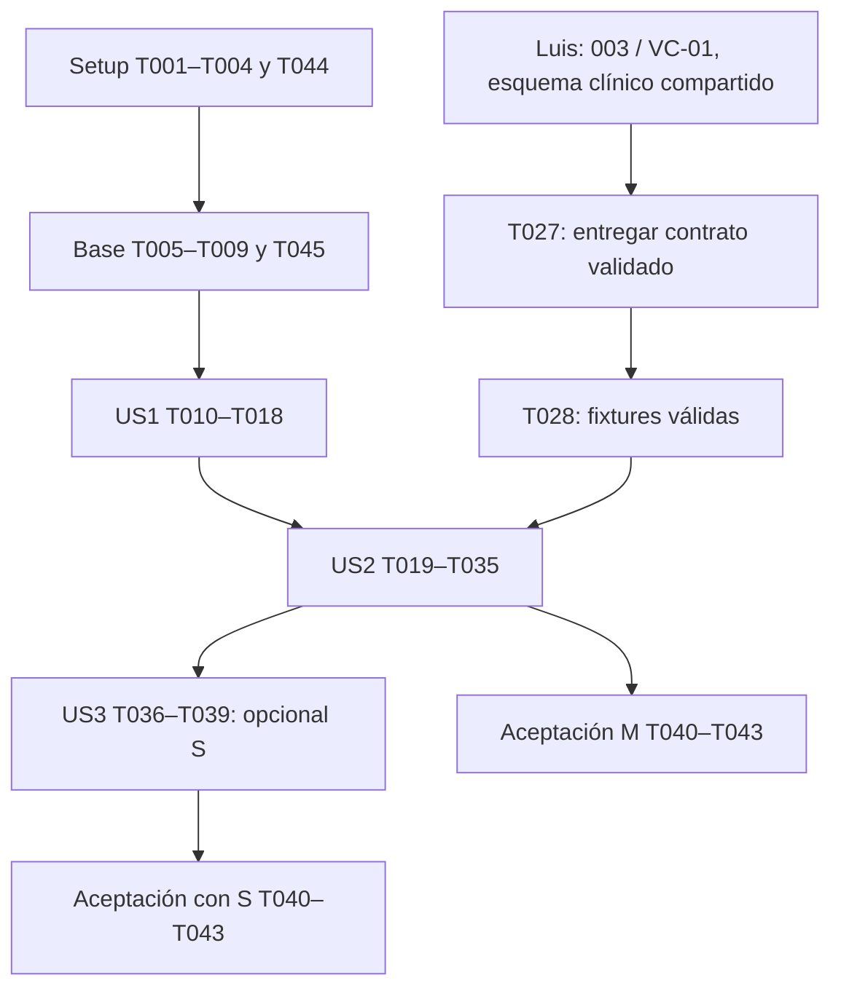

# Coordinación de tareas — acceso y pacientes

Las 45 tareas de esta funcionalidad tienen un responsable único. Las 43 originales
conservan sus IDs; T044 separa la configuración frontend de T004 y T045 separa los
runners frontend de T009. No se ha completado ninguna tarea.

| Miembro | Fuente editable | Responsabilidad |
|---|---|---|
| German (A) | [german.md](german.md) | Frontend y coordinación E2E |
| Jeroben (B) | [jeroben.md](jeroben.md) | Backend, base de datos e infraestructura |
| Luis (C) | [luis.md](luis.md) | Contrato clínico compartido 003/VC-01 |

## Reglas de trabajo y entregas

- Trabajar en `frontend/`, `backend/` e `ia/` del mismo repositorio.
- Cada responsable actualiza sus casillas en su archivo. `tasks.md` es una vista
  generada compatible con lectura de Spec Kit; regenerar con
  `python3 scripts/sync-team-tasks.py` y comprobar con `--check`.
- Los IDs no indican el orden por sí solos: T044 pertenece a Setup y T045 a base
  común. Mantener prioridades P1/M (US1/US2) y P2/S (US3).
- Jeroben mantiene `.gitignore`, `compose.yaml` y `docs/DESARROLLO.md`; German
  le entrega la configuración/orígenes frontend. German mantiene package.json,
  router y configuración frontend; Luis mantiene esquema y ejemplos compartidos.
- Cada miembro registra evidencia en `specs/001-acceso-pacientes/validation/<nombre>.md`.
  German consolida en `validation.md` al cerrar T043; no escribir a la vez en
  el mismo informe ni marcar tareas de otro responsable.
- German coordina T018/T035/T039/T043; Jeroben ejecuta y entrega resultados backend.
  Tener un responsable único no elimina la colaboración requerida ni acredita pruebas.
- Luis entrega a Jeroben y German esquema v1.1 y ejemplos validados en T027.
  Jeroben entrega API, usuarios y datos ficticios; German entrega integración,
  resultados de build/E2E y orígenes para CORS. No cambiar claves o contratos sin
  comunicarlo a sus consumidores.

## Criterios por fase

## Phase 1: Setup — estructura y dependencias

Crear backend y frontend en este mismo checkout, con dependencias reproducibles por componente. No crear worktrees ni otro repositorio.

**Checkpoint**: Completar y validar esta fase antes de aceptar los incrementos que dependen de ella.

## Phase 2: Foundational — base común

Completar esta fase antes de las historias. No introducir modelos de borrador/audio, endpoints clínicos de escritura ni nuevas dependencias de proveedores IA.

**Checkpoint**: Completar y validar esta fase antes de aceptar los incrementos que dependen de ella.

## Phase 3: User Story 1 — Acceder como médico (P1 / M)

Objetivo: iniciar sesión, consultar identidad y salir de forma explícita. Prueba independiente: con médicos ficticios, login/me válidos, rechazo de credenciales y sesiones inválidas, cancelación o confirmación de salida con trabajo local. No depende de los modelos de pacientes ni de IA.

**Checkpoint**: US1 demostrable sin pacientes ni IA; los tests anteriores pasan y la salida no afirma revocar JWT.

## Phase 4: User Story 2 — Encontrar y registrar al paciente correcto (P1 / M)

Objetivo: buscar/registrar pacientes y consultar expediente con versiones de solo lectura. Prueba independiente: sesión autenticada preparada, seis pacientes ficticios, búsqueda García/garcia y fechas, aviso de coincidencias, alta con expediente único, historial y nota íntegra. La lectura completa requiere el esquema compartido de 003/VC-01, no el pipeline IA ni las escrituras de 004/005.

**Checkpoint**: US2 demostrable con API real, pacientes y notas válidas; dependencia compartida resuelta antes de aceptar la historia.

## Phase 5: User Story 3 — Corregir la ficha del paciente (P2 / S)

Objetivo: editar ficha sin alterar el expediente ni las versiones de notas. Mejora opcional después del alcance M. Prueba independiente: paciente y sesión preparados; PATCH permitido actualiza ficha, expediente queda inmutable y el lector de notas no habilita editar identificación dentro de su contenido.

**Checkpoint**: US3 verificada como mejora S o explícitamente diferida; no convierte S en obligación M.

## Phase 6: Polish — aceptación transversal

Aplicar al alcance M y, si se entrega, a US3. Toda casilla representa trabajo pendiente, no código ya implementado ni prueba ya ejecutada.

**Checkpoint**: Completar y validar esta fase antes de aceptar los incrementos que dependen de ella.

## Dependencies & Execution Order

### Dependencias de fases

- Setup T001–T004 + T044 → base común T005–T009 + T045 → US1 T010–T018.
- US1 → US2 T019–T035 para demostración integrada con sesión real.
- US2 → US3 T036–T039, solo si se entrega la mejora S.
- Aceptación transversal T040–T043 después de US1/US2; incorporar US3 si se decide entregarla.

### Dependencias internas y frontera con 003

- T001 antes de T005/T006/T009 backend; T002 antes de T007/T008/T045 frontend. T044 coordina configuración frontend con T004 antes de pruebas integradas.
  T003/T004 deben estar disponibles para ejecutar pruebas reales de PostgreSQL.
- US1: T010/T011 pueden redactarse simultáneamente; T012 → T013/T014;
  T015 → T016 → T017; T018 requiere ambas partes implementadas.
- US2: T019–T022 son pruebas en archivos distintos. T023 → T024; T025 se
  escribe tras T023, y se completa con derivados tras T026/T029. T026 necesita
  el modelo Paciente. T027 bloquea T028, la validación de contenido completo de
  T034 y la aceptación T035. T029 depende de T026; T030/T031 preparan T032–T034.
  T032 puede avanzar y validarse con historial vacío antes de resolver T027.
- Luis es responsable de T027: entrega el contrato compartido de 003/VC-01.
  No requiere tener listo el pipeline IA para desbloquear el historial. German y
  Jeroben revisan claves y ejemplos antes de consumirlos. Si falta el esquema,
  T027/T028/T034/T035 permanecen pendientes; acceso/búsqueda/alta pueden avanzar.
- US3: T036 → T037/T038 → T039. T037 y T038 afectan archivos de US2, por lo
  que no deben editarse a la vez que esa historia en curso.
- Las rutas compartidas settings.py, router.tsx, package.json, serializers.py,
  cargar_demo.py y validation.md requieren edición serializada aunque otras tareas
  trabajen en paralelo. Los prerrequisitos de esta sección prevalecen sobre el orden
  numérico cuando una tarea permite avanzar un componente independiente.

### Ejemplos de paralelismo

- Setup: T002 (frontend) y T003 (PostgreSQL) pueden avanzar mientras T001 prepara backend.
- US1, tras la base común: redactar T010 (pruebas backend) y T011 (pruebas de sesión frontend)
  en paralelo. Tras T012/T014 y T015, API y pantalla pueden avanzar en archivos separados.
- US2, tras US1: redactar T019, T020, T021 y T022 en paralelo. No ejecutar las pruebas
  de concurrencia hasta tener PostgreSQL, migraciones y secuencia. Después de los modelos,
  T029 (lectura API) y T030 (formatos frontend) no comparten archivos.
- US3: T036 puede redactarse mientras se prepara la revisión frontend de la historia;
  T037 y T038 pueden desarrollarse en paralelo una vez estabilizada US2 y definidos
  los tests, porque backend y frontend no comparten archivos.

## Trazabilidad y validación por historia

| Origen | Historia / tareas principales | Evidencia prevista |
|---|---|---|
| RF-01 / FR-001 | US1 T010, T012–T016, T018 | A01–A04, login/me y perfil real |
| RF-02 / FR-002 | US1 T011, T015, T017–T018 | Cancelar conserva; confirmar elimina trabajo local; 401 no descarta |
| RF-03 / FR-003 | US2 T019, T024–T025, T030–T032, T035 | P01/P02; acentos, expediente y fechas |
| RF-04 / FR-004 | US2 T019, T021–T025, T031–T032, T035 | P03–P06; mínimos, coincidencias, autoría y concurrencia |
| RF-05 / FR-005 | US2 T027–T028, T035 | P07; 6 pacientes ficticios y alergia a penicilina |
| RF-06 / FR-006 | US2 T020, T026, T028–T029, T033, T035 | N01; una fila por nota, diagnóstico vigente y orden |
| RF-07 / FR-007 | US2 T020, T026–T029, T034–T035 | N01–N03; detalle completo y versiones inmutables |
| RF-08 / FR-008 (S) | US3 T036–T039 | S01; ficha editable, expediente y contenido histórico intactos |
| RNF-01 | T013, T028, T016, T042 | Datos ficticios visibles y fixtures coherentes |
| RNF-03 | T004–T005, T041 | HTTPS y CORS por entorno, diferenciando local/desplegado |
| RNF-04 / SC-004 | T005–T006, US1, T040 | Autenticación en todas las rutas disponibles, sin credenciales expuestas |
| RNF-08 | T008, T030, T042 | Revisión de teclado, foco, contraste y español de México |
| SC-001 | T018, T035 | Acceso → búsqueda → expediente con API real |
| SC-002 | T028, T035 | 6 pacientes, notas previas y alergia de demo |
| SC-003 | T019, T032, T035 | Igualdad de búsqueda García/garcia |
| CA-08 | T040 parcial en 001; completa en 004 | POST /api/notas se verifica cuando se implemente; no inventar endpoint aquí |

## Implementation Strategy

1. Completar Setup y base común; demostrar US1 como primer incremento útil.
2. Entregar búsqueda y alta de US2 sin esperar el pipeline de audio; preparar el
   contrato de esquema compartido 003/VC-01 para notas y versiones de ejemplo.
3. Completar historial/detalle y ejecutar aceptación de US1 + US2 como alcance M
   de **esta funcionalidad**. US1 sola no satisface los requisitos de pacientes.
4. Entregar US3 solo después de M. Si se difiere PATCH, mantener T036–T039 pendientes
   y documentar esa decisión sin presentar las ocho operaciones como implementadas.
5. Ejecutar T040–T043; conservar resultados reales y bloqueos. No ampliar a captura,
   autorización o correcciones de otras funcionalidades dentro de este checklist.

Este checklist describe trabajo futuro; las instrucciones de validación HTTPS
no acreditan un despliegue realizado.
La creación de tasks.md no marca pasos completados ni modifica un backlog externo.
